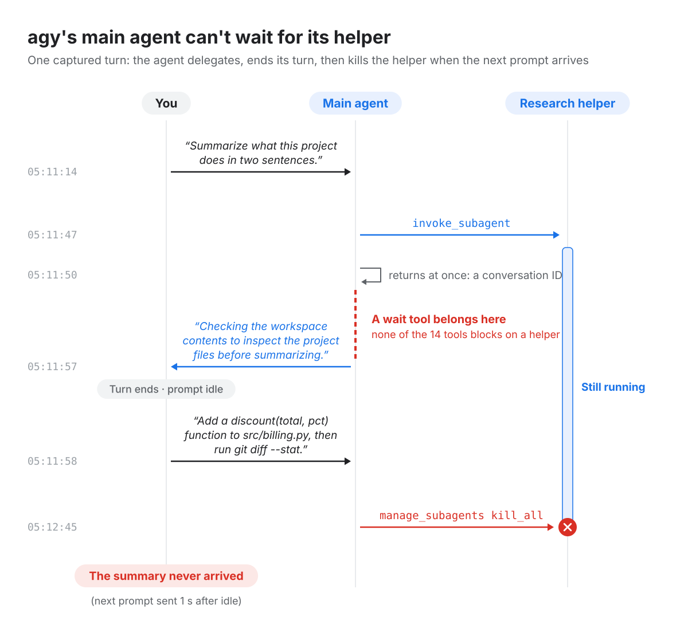
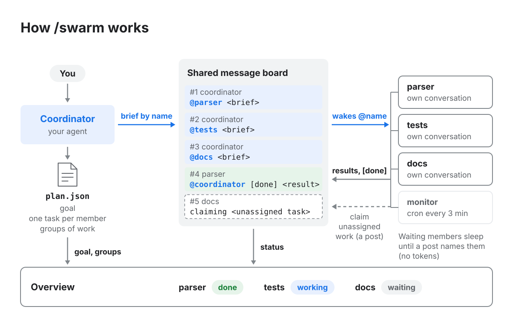
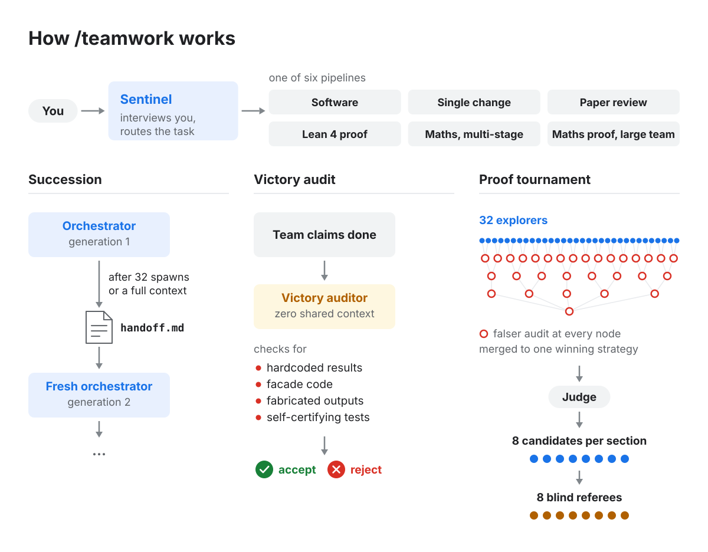

# Helpers, swarms and timers: how `agy` runs more than one agent

`agy` 1.5.14 lets the main agent start helpers in their own conversations, run a swarm of agents that talk through a shared board, and set timers that wake an agent later. Every one of these runs in the background: the caller's turn ends, and results come back as injected messages.

## A helper is a separate conversation that reports back by message

The main agent starts a helper with `invoke_subagent`, passing `TypeName`, `Role` (a short job title shown in the UI), `Prompt`, and optionally `Model` (`inherit` by default) and `Workspace` (`inherit` uses the caller's workspace, `branch` an isolated copy). The call returns within seconds with the helper's `conversationId`, the path of its transcript and its workspace; it never waits for the helper's answer. The tool description says so: "It runs in the background with its own prompt and sends you a message when it completes or needs guidance; there is no need to poll."

The system prompt lists three helper types: `self` ("inherits the parent agent's full configuration including tools, system prompt, and model"), `research` and `image-generator`. `define_subagent` adds a type for the rest of the conversation, with its own `SystemPrompt` and switches `EnableWriteTools`, `EnableSubagentTools` and `EnableMCPTools`. `manage_subagents` lists the caller's direct helpers and kills one or all of them; "Killing a subagent also kills its descendants and deletes their branched workspaces". `send_message` sends to a conversation ID.

The helper receives its brief as its first user entry, wrapped as a `<SYSTEM_MESSAGE>` from the caller's conversation ID with `MESSAGE_PRIORITY_HIGH`. Its system prompt then tells it that nothing it writes reaches the caller unless it calls `send_message`: "Your response is NOT automatically relayed — if you do not call send_message, the caller will only know that you have gone idle." The report arrives in the caller's conversation as another `<SYSTEM_MESSAGE>`, either as a new user entry when the caller is idle or appended to the caller's next tool result when it is busy.

Evidence:
- Traffic: [launching the research helper and receiving its report](../../resources/cli/traffic/research-helper.md); [a report appended to an unrelated tool result](../../resources/cli/traffic/injected-messages.md)
- Tool declarations: [main-agent.json](../../resources/cli/tool-declarations/main-agent.json); [invoke_subagent-d9463bae.txt](../../resources/cli/binary-1.5.14/tool_descriptions/invoke_subagent-d9463bae.txt), [define_subagent-3993a60c.txt](../../resources/cli/binary-1.5.14/tool_descriptions/define_subagent-3993a60c.txt), [manage_subagents-42aee0c4.txt](../../resources/cli/binary-1.5.14/tool_descriptions/manage_subagents-42aee0c4.txt)
- Prompt text: [subagents.txt](../../resources/cli/binary-1.5.14/system_sections/subagents.txt), [subagent_reminder.txt](../../resources/cli/binary-1.5.14/system_sections/subagent_reminder.txt), [self-description.txt](../../resources/cli/binary-1.5.14/subagents/self-description.txt), [image-generator.txt](../../resources/cli/binary-1.5.14/subagents/image-generator.txt)
- Binary: `jetski/cortex/mixins.(*SubagentReminderSection).Content` renders the helper's `<subagent_reminder>`
- Server: [`invoke-subagent-config`](../../resources/cli/server-switches/INDEX.md#invoke-subagent-config), [`send-subagent-initial-prompt-as-message`](../../resources/cli/server-switches/INDEX.md#send-subagent-initial-prompt-as-message), [`enable-image-generator-subagent`](../../resources/cli/server-switches/INDEX.md#enable-image-generator-subagent), [`enable-browser-subagent-v2`](../../resources/cli/server-switches/INDEX.md#enable-browser-subagent-v2)

## The research helper is read-only by sandbox, not only by instruction

The research helper's system prompt is 6,503 bytes in four sections: an identity paragraph (595 bytes: "You have read-only access and cannot make any changes to the codebase… NEVER run commands that write, modify, delete, install, or otherwise change any file or state"), `user_information`, `subagent_reminder`, `messaging`, and the same 3,709-byte `artifacts` section the main agent gets, which explains how to write report files it cannot write. The artifacts section is 57 % of its prompt.

It gets six tools: `read_file`, `search_web`, `run_command`, `send_message`, `schedule` and `manage_task`. Its `run_command` has no `BypassSandbox` parameter, and the tool configuration the client uploads for it carries `"readOnlySandbox":true` and `"disableSandboxBypass":true`. Inside that sandbox the workspace, `/tmp` and the helper's own conversation folder are mounted read-only, apart from a scratch folder of its own, and there is no network. Asked to run commands that write, the helper declined each one ("Not executed: as a read-only research subagent, I cannot run commands that write, create, or modify files or state"), and `curl` failed with "Could not resolve host".

It keeps `schedule`, with daemon timers enabled in its configuration, and `manage_task`. The server switch `ambient_subagent_read_only` (false) is not read by the client.

Evidence:
- Traffic: [research helper tools, configuration, refused writes](../../resources/cli/traffic/research-helper.md)
- Prompt text: [research-subagent.txt](../../resources/cli/system-prompts/research-subagent.txt); [research.txt](../../resources/cli/binary-1.5.14/subagents/research.txt), [research-description.txt](../../resources/cli/binary-1.5.14/subagents/research-description.txt)
- Tool declarations: [research-subagent.json](../../resources/cli/tool-declarations/research-subagent.json)
- Binary: `jetski/cortex/command.readOnlySandboxScratch` and `jetski/cortex/command.demoteWritableMountsIfReadOnly` build the read-only mounts when the command config's read-only flag is set

## Typing while a helper runs doesn't stop it, and nothing makes the agent keep it

No tool lets the main agent block until a helper answers. After `invoke_subagent` it says it will report back and ends its turn ("I've launched the research subagent to explore the project and will summarize its findings once it finishes."). The screen shows the running helper below the prompt, as "● Agent(research: Codebase Researcher) · Gemini 4 Neon  Running command" with "· 1 subagent" in the status bar.

If the user sends another prompt then, the helper keeps running. In a captured session the next prompt (add a function, then run `git diff --stat`) arrived one second after the turn ended. The main agent made the edit; the helper's report, timestamped 14:21:44, was appended to the result of one of those commands; and the final answer carried both the diff summary and the helper's project summary. In headless mode (`agy -p`) the process stays alive until the helper reports, prints the summary, and exits.

Whether a promised answer arrives is still up to the model. The main agent has `manage_subagents` with `kill_all`, nothing in the prompt says to keep a helper whose answer it promised, a kill is not shown to the user as a lost answer, and the review models' rubric lists "killing the agent's own tasks" among routine actions. The sequence diagram shows a turn in which the main agent, busy with the next prompt, killed the helper before it reported (captured with 1.5.11; 1.5.14 has the same `manage_subagents` tool and description).

Evidence:
- Traffic: [the report arriving during the next prompt](../../resources/cli/traffic/injected-messages.md); [the report arriving while idle in headless mode](../../resources/cli/traffic/research-helper.md)
- Tool declarations: [main-agent.json](../../resources/cli/tool-declarations/main-agent.json) (no tool waits on a helper); [manage_subagents-42aee0c4.txt](../../resources/cli/binary-1.5.14/tool_descriptions/manage_subagents-42aee0c4.txt) (same as 1.5.11)
- Prompt text: [monitor-config.textproto](../../resources/cli/binary-1.5.14/safety/monitor-config.textproto) ("Listing or checking status of the agent's own subagents/tasks, waiting/sleeping, killing the agent's own tasks.")
- Diagram: [waiting.svg](../../resources/diagrams/waiting.svg)

## A swarm is a coordinator and members talking on one board

`/swarm` is the only way in. The swarm skill has `disable-model-invocation: true`, so the model can't start it, and the `swarm` tool description says "NEVER start or inspect a swarm on your own". When the user types `/swarm`, the client puts the 20,850-byte coordinator skill into the user entry, and the main agent becomes the coordinator. The skill tells it "Do not do the work": "Technical work goes to the swarm. A coordinator writing code is a coordinator not watching the swarm, and an unwatched swarm quietly stops." It keeps all 14 of its tools, `write_file` and `edit_file` included. In a captured swarm it made eight calls: it read the `swarm_pane` skill, listed the workspace, titled the swarm, added four members and wrote `plan.json`, which feeds the swarm's Overview screen.

`swarm{action:"add"}` starts a member in a conversation of its own, under a short name, on the coordinator's model unless another is named, and posts its brief on the board as an @mention. The brief is all the member knows: "by default a worker starts fresh and sees nothing of this conversation". `workspace` is `inherit` (the default, for readers and verifiers), `share` (its own working copy) or `branch` (an isolated clone). Members can add helpers of their own; the coordinator alone can title the swarm.

A member's system prompt is the main agent's with a `<swarm_worker>` section added: 26,002 bytes, of which `swarm_worker` is 8,657. It has 13 tools: the main agent's minus `invoke_subagent`, `define_subagent`, `manage_subagents` and `send_message`, plus `post_message`, `read_board` and `swarm_wait`. Its first entry is its assignment: "You have just started. Your assignment (recorded on the board as #2 for @json-names-test):" followed by the brief.

The board is shared and numbered. `read_board` returns messages oldest first with a sequence number; `post_message` posts under the member's name; `swarm_wait` parks the member until a post concerns it ("Waiting costs nothing: you consume no tokens while waiting"). By default only a post that names the member, or `@all`, wakes it; it then arrives as "[swarm] new board message #5". The worker rules make @mentions the wake-up mechanism: "@name is a wakeup doorbell, never a CC. Every @mention wakes that agent and costs it a turn." They also say "Do not greet, and do not acknowledge", "Post results, not just status", and "Start your final result post with [done]".

Quota is handled inside the swarm. `swarm{action:"models"}` shows each model's `quota_remaining`; a member whose turn fails on quota stays `waiting`, and the coordinator is told to move it with `swarm{action:"model"}`, which keeps its conversation. The skill warns: "Nothing restarts on its own after quota runs out."

Evidence:
- Traffic: [coordinator calls, the add result, a member's first entries](../../resources/cli/traffic/swarm.md); [`/swarm` putting the skill into the user entry, a board notification](../../resources/cli/traffic/injected-messages.md)
- Prompt text: [native_swarm/SKILL.md](../../resources/cli/binary-1.5.14/skills/native_swarm/SKILL.md), [swarm_pane/SKILL.md](../../resources/cli/binary-1.5.14/skills/swarm_pane/SKILL.md), [swarm-member.txt](../../resources/cli/system-prompts/swarm-member.txt), [swarm_worker.txt](../../resources/cli/binary-1.5.14/swarm/swarm_worker.txt), [worker-briefing.txt](../../resources/cli/binary-1.5.14/swarm/worker-briefing.txt), [board-head-hook.txt](../../resources/cli/binary-1.5.14/swarm/board-head-hook.txt), [swarm.rendered.txt](../../resources/cli/binary-1.5.14/tool_descriptions/core/swarm.rendered.txt), [swarm_wait-940bad50.txt](../../resources/cli/binary-1.5.14/tool_descriptions/swarm_wait-940bad50.txt), [read_board-da92d116.txt](../../resources/cli/binary-1.5.14/tool_descriptions/read_board-da92d116.txt)
- Tool declarations: [swarm-member.json](../../resources/cli/tool-declarations/swarm-member.json)
- Binary: `jetski/cortex/core/native_swarm/nativeswarm.NewManageSwarmTool` builds the `swarm` tool, with `(*manageSwarmTool).isCoordinator` separating coordinator rights; `nativeswarm.quotaWarning` writes the `[quota]` warning; `nativeswarm.NewHeadHook` adds the board-head reminder
- Server: [`enable-native-swarm`](../../resources/cli/server-switches/INDEX.md#enable-native-swarm), [`enable-swarm-narrator`](../../resources/cli/server-switches/INDEX.md#enable-swarm-narrator) (false)

## The stall monitor is a member on a three-minute timer

Every member can end up asleep waiting on someone else, so the coordinator adds a monitor when the `swarm_monitor` skill is in its list ("You are this swarm's stall monitor. Load the swarm_monitor skill and follow it. Post only to break a stall."). The monitor reads the whole board, then calls `schedule` with `CronExpression: "*/3 * * * *"`, `IsDaemon: true` and the prompt "[monitor] tick: check the swarm for a stall". `IsDaemon` "must be true, or your timer keeps the user's conversation from ever looking idle."

On each tick it reads the new posts and `read_board{status: true}`, which gives each member's `state` (waiting, working, stopped, killed), what it is parked on and its last read and posted sequence numbers. The swarm counts as stalled when every live member except the monitor is waiting or stopped and the job isn't done. The monitor then posts once, to the one member who can act, citing posts by number: "@coordinator [stall] #41 (parser's result) and #42 were addressed to nobody". It doesn't repeat an alert unless something changed or three more ticks passed, gives up on a stall after three alerts, and stops its timer when the coordinator posts `[done]` or nothing has moved for five ticks.

Each tick is a model turn on the monitor's model, whether or not anything is wrong. In the captured swarm the first tick arrived 18 seconds after the monitor started waiting.

Evidence:
- Traffic: [the monitor's timer and first tick](../../resources/cli/traffic/swarm.md)
- Prompt text: [swarm_monitor/SKILL.md](../../resources/cli/binary-1.5.14/skills/swarm_monitor/SKILL.md); [native_swarm/SKILL.md](../../resources/cli/binary-1.5.14/skills/native_swarm/SKILL.md) ("The monitor")
- Server: [`enable-swarm-monitor`](../../resources/cli/server-switches/INDEX.md#enable-swarm-monitor)

## `/teamwork` and `/boost` are fixed pipelines built into the client

`/teamwork` starts a team defined in the client's `teamwork` packages. A sentinel "Manages the user relationship and routes to either a Pipeline Conductor (multi-stage) or Swarm Orchestrator (simple tasks)". Orchestrators hand over to a fresh successor ("Self-succeed at **32** spawns") and keep a "Heartbeat cron (every **20** min), liveness checks, lifecycle tracking". When the team claims to be done, the sentinel spawns a victory auditor: "Independent post-victory auditor. Spawned by the Sentinel when the team claims project completion. Conducts a 3-phase audit (timeline, cheating detection, independent test execution) with zero shared context from the implementation swarm." With the server's `disable-teamwork-forced-flash-model` at `false`, the orchestrator runs on Gemini Flash whatever model the user picked.

`/boost` gives the main agent an orchestrator prompt that delegates coding to a hidden `DeepCoder` helper and investigations to `DeepInvestigator`. DeepCoder is a "pipeline coordinator" told to "NEVER write code or edit files". It runs a first worker that "implements initial solutions from scratch" and then an improvement worker that "breaks and fixes prior implementations", whose prompt says "A review that finds nothing and changes nothing is almost always a failed review."

Evidence:
- Binary: `jetski/cortex/config.TeamworkDefaultsToFlash`; `jetski/cortex/customizations/builtin/owl.OrchestratorPrompt`; `jetski/cortex/customizations/builtin/owl/deepcoder.CoordinatorPrompt`; the sentinel, succession and victory-auditor texts are strings in the `jetski/cortex/customizations/builtin/teamwork` packages
- Prompt text: [coordinator-reminder.txt](../../resources/cli/binary-1.5.14/hooks/coordinator-reminder.txt)
- Server: [`enable-teamwork-subagent`](../../resources/cli/server-switches/INDEX.md#enable-teamwork-subagent), [`disable-teamwork-forced-flash-model`](../../resources/cli/server-switches/INDEX.md#disable-teamwork-forced-flash-model), [`enable-owl-slash-command`](../../resources/cli/server-switches/INDEX.md#enable-owl-slash-command)
- Diagram: [teamwork.svg](../../resources/diagrams/teamwork.svg)

## `schedule` wakes the agent with each tick

`schedule` sets a one-shot timer (`DurationSeconds`) or a cron job (`CronExpression`), optionally with `MaxIterations`, `ExactTiming`, a `TimerCondition` that a matching message cancels, and `IsDaemon` "for a cron that should keep firing after the current task is done". It runs as a background task and returns at once; the description says to "end your turn (call no more tools) to wait for notifications". Each firing arrives as a `<SYSTEM_MESSAGE>` from `<conversation>/task-N` with the prompt and an iteration count, and starts a model turn. `manage_task` with `kill` cancels it.

The cron parser accepts expressions that never match and fires them anyway. `0 0 31 2 *` (31 February) fired at 12:34:11, 12:34:28 and 12:34:40, three model turns in 29 seconds, until the task was killed.

The main agent, every swarm member and the research helper have `schedule`. The safety rubric names "background loops meant to outlive the session" as a risk, while the local allow-list of the tool-safety monitor clears `schedule` without review.

Evidence:
- Traffic: [the 31 February cron](../../resources/cli/traffic/schedule-cron.md); [a timer tick](../../resources/cli/traffic/injected-messages.md)
- Prompt text: [schedule.txt](../../resources/cli/binary-1.5.14/tool_descriptions/core/schedule.txt), [manage_task-f063bd07.txt](../../resources/cli/binary-1.5.14/tool_descriptions/manage_task-f063bd07.txt), [monitor-config.textproto](../../resources/cli/binary-1.5.14/safety/monitor-config.textproto) (rubric line; `allowed_tools: "schedule"`), [agy_tool_safety.textproto](../../resources/cli/binary-1.5.14/safety/agy_tool_safety.textproto)
- Tool declarations: [main-agent.json](../../resources/cli/tool-declarations/main-agent.json), [swarm-member.json](../../resources/cli/tool-declarations/swarm-member.json), [research-subagent.json](../../resources/cli/tool-declarations/research-subagent.json)
