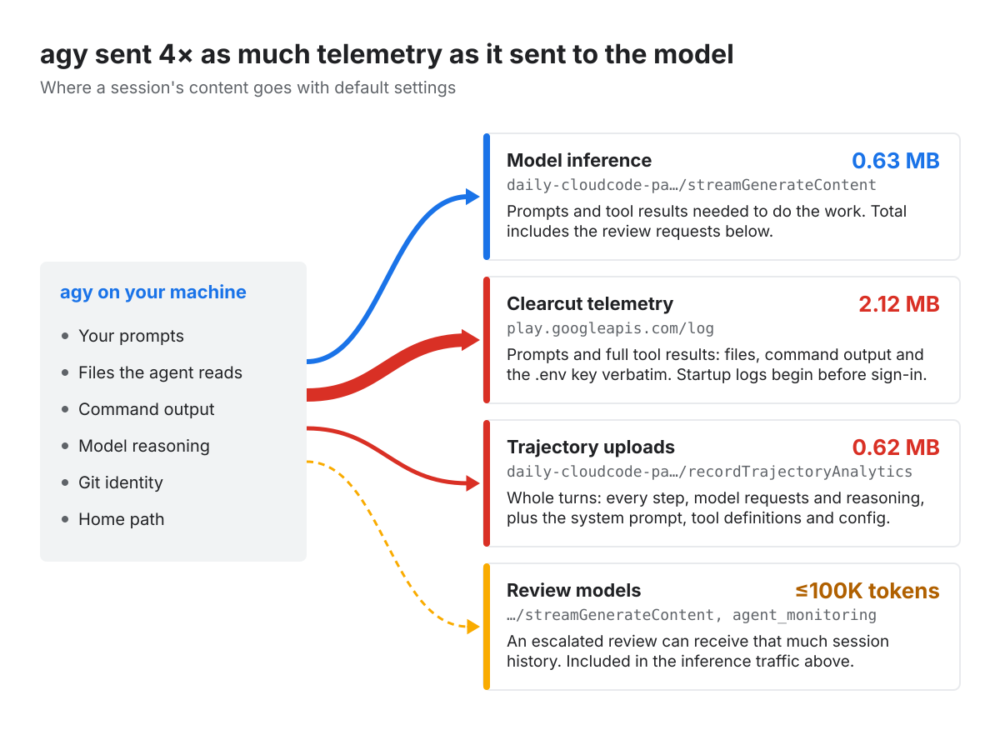

# How `agy` 1.5.14 is built: one binary, a local server, and Google's backends

`agy` is a single Go executable. It holds the terminal interface, a language server, and the agent core Google calls "cortex", all in one process. That process talks to a handful of Google endpoints for model calls, account data, server switches and telemetry. It keeps its state in a few directories under your home directory and updates itself in the background. It can also run as an Agent Client Protocol server so that an editor can drive it. Wire formats are in [the protocol reference](../../resources/cli/protocol/protocol-and-requests.md).

## One process holds the front end, the language server and the agent core

The binary's recovered function names fall into three large areas under `jetski/`:

| Area | Functions | What it does |
|---|---|---|
| `jetski/cli` | 8,881 | The terminal front end: rendering, slash commands, sign-in, settings, print mode (`-p`), the updater, plugins, `/swarm` and the ACP server |
| `jetski/language_server` | 7,411 | A local server with the Cloud Code client, conversation storage, the plugin and MCP machinery, and the API the front end uses |
| `jetski/cortex` | 13,208 | The agent: the trajectory (one conversation's steps), tools, permissions, customizations (rules, skills, hooks), the safety monitor (`policyguardian`, 1,613 functions), forks and compaction |

On start, `main.main.func4` calls `language_server.CreateLanguageServerAndServe` inside the same process. That function opens its listeners through `go_utils.NewPortListener`, which calls `net.Listen`, then sets up the HTTP handlers (`language_server.(*Server).setUpHTTPServeMux`). The running process listens on two loopback TCP ports. The front end's backend object, built by `cli/backend.NewServerBackend`, wires in the token storage (`cli/backend/auth.NewCLITokenStorage`), the auth provider that the Cloud Code client asks for tokens and endpoints (`codeassistclient.(*CLIAuthProvider)`), telemetry (`cli/analytics.Init`) and the local conversation search index.

The Cloud Code client, `language_server/code_assist_client/codeassistclient.(*CodeAssistClient)`, is the same component the desktop app's language server uses. The names show the code's history. "Jetski" is the internal project, a "cascade" is a conversation, and a "trajectory" is the record of its steps.

Commands the agent runs in the sandbox run in a fresh copy of `agy` that the main process starts for the purpose. That is described in [sandbox-and-permissions.md](sandbox-and-permissions.md).

Evidence:
- Binary: `main.main.func4` calls `jetski/language_server.CreateLanguageServerAndServe`, which calls `jetski/go_utils.NewPortListener` (a `net.Listen` wrapper) and `jetski/language_server.(*Server).setUpHTTPServeMux`
- Binary: `jetski/cli/backend.NewServerBackend` calls `jetski/cli/backend/auth.NewCLITokenStorage`, `jetski/language_server/code_assist_client/codeassistclient.(*CLIAuthProvider).SetTokenStorage` and `jetski/cli/analytics.Init`
- Binary: `jetski/cli/acp/server.bootBackend.func3` also calls `jetski/language_server.CreateLanguageServerAndServe`

## Every model call and account call goes to a Google endpoint

All network traffic goes to Google. The figure shows where a session's content goes with default settings, and how much of it goes to each destination.

| Endpoint | What it is for |
|---|---|
| `daily-cloudcode-pa.googleapis.com/v1internal:streamGenerateContent` | Every model call (the types are in the next section) |
| `daily-cloudcode-pa.googleapis.com/v1internal:loadCodeAssist` | The account's tier, paid plan, privacy notice and the Cloud project that every later call names |
| `…:fetchUserInfo` | Account settings, including the data-use setting (`userSettings.telemetryEnabled`) |
| `…:fetchAdminControls` | Organisation policy for business accounts. A consumer account gets `{}` |
| `…:retrieveUserQuotaSummary` | The quota groups and limits that `/usage` shows ([sign-in-and-plans.md](sign-in-and-plans.md#quotas-come-from-the-server-and-are-shown-in-usage)) |
| `…:fetchAvailableModels` | The model list: 39 entries in a 342 KB response, with per-model settings and the default model (`gemini-4-neon-high`) |
| `…:listExperiments` | 635 server switches ([server-switches.md](server-switches.md)) |
| `…/cascadeNuxes` | Announcements shown in the interface |
| `…:writeTrajectoryAcls`, `…:recordTrajectoryAnalytics` | Registering each conversation and helper, and uploading each finished turn ([data-collection.md](data-collection.md)) |
| `aicode.googleapis.com/v1alpha:fetchConfig` | A second experiment and model configuration, fetched at start and then every 60 seconds |
| `play.googleapis.com/log` | Clearcut telemetry batches, from the first seconds of the first run ([data-collection.md](data-collection.md)) |
| `oauth2.googleapis.com/token`, `www.googleapis.com/oauth2/v2/userinfo` | Sign-in, token refresh, and the account's name and email ([sign-in-and-plans.md](sign-in-and-plans.md)) |
| `www.gstatic.com/antigravity/plugins/marketplace.json` and `plugins-partners/marketplace.json` | Plugin catalogues |

In one traced two-prompt session, the agent's own model requests sent 0.54 MB, Clearcut sent 2.12 MB in 15 batches and three trajectory uploads sent 0.62 MB. The order of the start-up calls and the request layouts are in [the protocol reference](../../resources/cli/protocol/protocol-and-requests.md#start-of-a-session).

Evidence:
- Traffic: [the start-up calls and their response layouts](../../resources/cli/protocol/wire-account-and-config.md)
- Traffic: [destinations seen in a session](../../resources/cli/traffic/endpoints.md) (captured with 1.5.11)
- Session trace: [one session, traced](../../resources/cli/session-1/README.md)
- Server: [models list](../../resources/cli/server-switches/available-models.json), [switches](../../resources/cli/server-switches/INDEX.md)
- Binary: `jetski/language_server/code_assist_client/codeassistclient.(*CodeAssistClient).ListExperiments`, `.FetchAvailableModels`, `.RetrieveUserQuotaSummary`, `.FetchAdminControls`, `.FetchUserInfo`, `.ListCascadeNuxes`, `.WriteTrajectoryACLs`, `.RecordTrajectorySegmentAnalytics`

## Model calls are told apart by `requestType`

All model calls use one envelope (`project`, `requestId`, `model`, `userAgent: "antigravity"`, `requestType`, and a Vertex AI `request`). The `requestType` and the model say which part of `agy` made the call.

| Caller | `requestType` | Model | Purpose |
|---|---|---|---|
| Main agent | `agent` | The model you picked | Each step of your conversation: system prompt, tool declarations and the whole history, resent every call ([prompts-and-context.md](prompts-and-context.md)) |
| Research helper | `agent` | The model you picked | A read-only helper the agent starts with `invoke_subagent`. Its calls add `labels.subagent_type: research` and the parent conversation's ID ([agents-and-swarm.md](agents-and-swarm.md)) |
| `/boost`, `/teamwork`, `/swarm` members | `agent` | Per role | Multi-agent work ([agents-and-swarm.md](agents-and-swarm.md)) |
| Step review and history review | `agent_monitoring` | `gemini-3.5-flash-lite`, `gemini-4-hydrogen-sonar` | Score a pending tool call before it runs ([safety-reviews.md](safety-reviews.md)) |
| Command adjudicator | `agent` | `gemini-4-hydrogen-medium` | Decides whether a command that asks to leave the sandbox in auto mode is reversible ([safety-reviews.md](safety-reviews.md)) |
| Title generator | `checkpoint` | `gemini-3.5-flash-lite` | Names the conversation from its first prompt |
| Compaction | `checkpoint` | The model you picked | Summarises a long history ([prompts-and-context.md](prompts-and-context.md)) |
| Web search | `web_search` | `gemini-3.5-flash-lite` | Runs the agent's search query with Google Search as the only tool |

The web search call has its own system prompt. It begins "You are a search engine bot. You will be given a query from a user. Your task is to search the web for relevant information that will help the user. You MUST perform a web search."

In the traced session, the two prompts produced 9 main-agent calls, 6 research-helper calls, 8 step reviews and 1 title call.

Evidence:
- Traffic: [main model request](../../resources/cli/protocol/wire-model-request.md), [review, helper and title requests](../../resources/cli/protocol/wire-side-model-requests.md), [web search request](../../resources/cli/protocol/wire-web-search.md)
- Prompt text: [title-generator.txt](../../resources/cli/system-prompts/title-generator.txt), [research-subagent.txt](../../resources/cli/system-prompts/research-subagent.txt), [command-adjudicator.txt](../../resources/cli/system-prompts/command-adjudicator.txt)
- Session trace: [one session, traced](../../resources/cli/session-1/README.md)

## State lives under `~/.gemini/antigravity-cli`

Most of what `agy` keeps is in one directory. The names below appear in the binary. Files marked 600 are readable only by your user. The others use the default mode.

| Path | Contents |
|---|---|
| `settings.json` (600) | Your settings, for example `{"model": "Gemini 3.8 Flash (Medium)", "trustedWorkspaces": ["~/project"]}` |
| `antigravity-oauth-token` (600) | The OAuth token when no OS keyring is available ([sign-in-and-plans.md](sign-in-and-plans.md#the-token-goes-to-the-os-keyring-or-a-plain-json-file)) |
| `history.jsonl` (600) | Every prompt you typed, one JSON object per line with `display`, `timestamp` and `workspace` |
| `conversations/<id>.db` | One SQLite database per conversation, with tables `steps`, `gen_metadata`, `executor_metadata`, `trajectory_meta`, `trajectory_metadata_blob`, `parent_references` and `battle_mode_infos` |
| `conversation_summaries.db` | A SQLite index of all conversations: title, preview, step count, workspace and status, plus an FTS5 full-text table (`conversations_fts`) over the conversation text |
| `brain/<id>/` | The artifact directory for each conversation (below) |
| `installation_id`, `jetski_state.pbtxt` | The installation's UUID, completed onboarding steps and migration state |
| `log/cli-<timestamp>.log`, `cli.log` | Client logs. `cli.log` links to the newest |
| `annotations/`, `presence/`, `cache/`, `builtin/` | Per-conversation annotations, lock files, cached onboarding and announcement state, and the bundled skills and plugins |

Next to it, `~/.gemini/config/` holds `config.json` (plugin switches such as `{"plugins": {"swarm": {"enabled": true}}}`) and `mcp_config.json`. `~/.cache/antigravity/bin/` holds the bundled ripgrep, extracted as `rg_embedded-<hash>`.

The brain directory is what the agent sees as its own workspace. The system prompt gives it the path and tells it to write artifacts there: "All artifacts should be written to the artifact directory: `<appDataDir>/brain/<conversation-id>`". It also says scratch files go in `scratch/` "They will be persisted". It points the agent at its own transcripts as well: "Transcripts are located directly at `<appDataDir>/brain/<conversation-id>/.system_generated/logs/transcript.jsonl` (and `transcript_full.jsonl`)." Beside the transcripts, `.system_generated/` holds each step's output (`steps/<n>/output.txt`), messages and helper records. In the sandbox, the agent can read and write this whole tree ([sandbox-and-permissions.md](sandbox-and-permissions.md)).

Evidence:
- Binary: strings `settings.json`, `history.jsonl`, `conversation_summaries.db`, `conversations_fts`, `jetski_state.pbtxt`, `installation_id`, `.system_generated`, `transcript_full.jsonl`, `last_conversations.json`, `mcp_config.json`, `rg_embedded`; the token file name is assembled in `jetski/cli/backend/auth.NewCLITokenStorage`
- Prompt text: [main-agent.txt](../../resources/cli/system-prompts/main-agent.txt) (artifact, scratch and transcript paths, and `Artifact Directory Path: ~/.gemini/antigravity-cli/brain/[id]`)

## Updates are downloaded in the background and checked only against the manifest

On start, `cli/updater.triggerUpdateShared` checks `AGY_CLI_DISABLE_AUTO_UPDATE`, checks whether the last check is still fresh (`ttlStillFresh`), and if not starts a separate background process through `os/exec` (the binary has a `--bg-updater` flag). That process takes a file lock (`flock`) and builds the manifest URL from the release server's base URL, using the pattern `%s/manifests/%s_%s%s.json`. It fetches the manifest, decodes the JSON and compares versions (`checkManifest`, `isNewerVersion`). It then downloads the archive and hashes it with SHA-512. A mismatch fails with "Integrity failure: checksum mismatch. Expected %s, got %s". Finally it extracts the executable from the `.tar.gz` and renames it over the installed one. `TriggerUpdateAndRelaunch` waits for that status and restarts `agy`.

The expected digest comes from the same manifest (`json:"sha512"`). The update path calls no signature check: `runUpdateShared` uses SHA-512 and nothing else from the crypto packages. The release server's base URL can be changed with `--release_base_url` ("Base URL of the release server for the auto-updater").

Evidence:
- Binary: `jetski/cli/updater.triggerUpdateShared` reads `AGY_CLI_DISABLE_AUTO_UPDATE` and calls `jetski/cli/updater.ttlStillFresh`
- Binary: `jetski/cli/updater.runUpdateShared` calls `jetski/cli/updater.GetManifestURLFromBase`, `jetski/cli/updater.checkManifest`, `crypto/internal/boring.NewSHA512`, `jetski/cli/updater.extractTarGzMember` and `jetski/cli/updater.renameWithRetry`
- Binary: strings `%s/manifests/%s_%s%s.json`, `Integrity failure: checksum mismatch. Expected %s, got %s`, `--release_base_url`

## `agy acp` runs the same agent behind a JSON-RPC interface

`agy acp` starts an Agent Client Protocol server ("Start the Agent Client Protocol (ACP) stdio server") that speaks JSON-RPC 2.0 over stdin and stdout. It boots the same backend and language server as the terminal interface (`acp/server.bootBackend`). Its flags include:

| Flag | Help text |
|---|---|
| `--process-per-session` | "Serve each session from an isolated worker process" |
| `--worker` | "Serve a single session for an ACP front process (internal)" |
| `--ide-mcp-port` | "Port for host IDE tools MCP server (requires 'nc' in $PATH)" |
| `--login` | "Log in with Google interactively, then exit (ACP terminal auth)" |
| `--dangerously-skip-permissions` | "Auto-approve all tool permission requests" |
| `--cloud_code_endpoint` | "CCPA API URL" (default `https://daily-cloudcode-pa.googleapis.com`) |
| `--disable-telemetry` | "If true, disable telemetry" |

ACP has its own auth manager (`acp/auth.(*Manager)`) with four methods: `oauth-personal`, `oauth-business`, `gemini-api-key` and `agent-platform`. Unlike the terminal sign-in, its browser login listens on a local callback, `http://localhost:%d/auth/callback` (`acp/auth.(*loopbackLogin)`). The handshake and what it leaves out are in [the protocol reference](../../resources/cli/protocol/protocol-and-requests.md#acp) and [agents-and-swarm.md](agents-and-swarm.md).

Evidence:
- Traffic: [ACP handshake](../../resources/cli/protocol/wire-acp.md)
- Binary: `jetski/cli/acp/server.bootBackend.func3`, `jetski/cli/acp/auth.newBrowserLogin`, `jetski/cli/acp/auth.(*loopbackLogin).LoginToken`, `jetski/cli/acp/auth.(*Manager).authenticateGeminiAPIKey`
- Binary: the flag help strings above and `http://localhost:%d/auth/callback`
