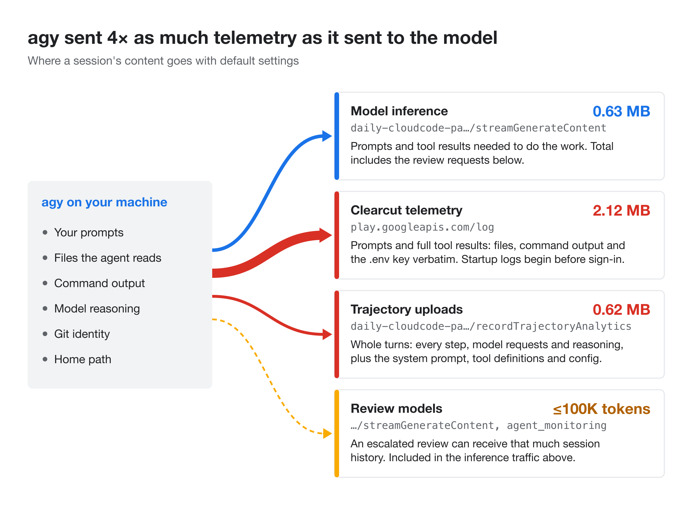
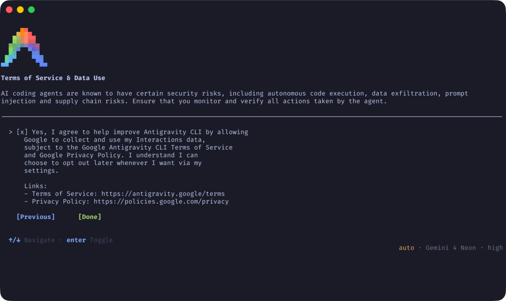

# What leaves the machine: telemetry, trajectory uploads and identifiers

Every connection `agy` 1.5.14 makes goes to Google. Apart from the model calls, two telemetry channels carry the session's content: Clearcut logging at `play.googleapis.com/log` and trajectory uploads at `recordTrajectoryAnalytics`. With the default setting both carry files the agent read, command output, the user's prompts and the model's reasoning, including secrets in the workspace. Telemetry starts before sign-in. Switching "Enable Telemetry" off in `/config` stops the trajectory uploads and strips content fields from Clearcut records, but Clearcut keeps sending records with identifiers, metadata and step-by-step activity, and model calls and reviews are unchanged.

## Telemetry is most of what a session sends

In four minutes of an interactive session with two prompts, `agy` sent 72 requests with 3,373,195 bytes of decoded request bodies. Model inference (`streamGenerateContent`, 24 requests) accounted for 629,493 bytes. Clearcut (15 batches) accounted for 2,124,513 bytes and trajectory uploads (3) for 618,323 bytes, so telemetry was 4.4 times the model traffic. The remaining calls are small: account bootstrap (`loadCodeAssist`), quota, settings, admin controls, model list, experiment flags, the `fetchConfig` poll every 60 s, the profile and avatar, the plugin catalogues and the onboarding configuration. Their request and response layouts are in [wire-account-and-config.md](../../resources/cli/protocol/wire-account-and-config.md), and the order they go out in is in [Protocols and request flows](../../resources/cli/protocol/protocol-and-requests.md).

| Destination | What it receives |
|---|---|
| `play.googleapis.com/log` | Clearcut batches: tool steps, model requests, hook and monitor results, analytics events, error traces |
| `daily-cloudcode-pa.googleapis.com/v1internal:streamGenerateContent` | Model requests for the agent, helpers, compaction, titles and reviews |
| `daily-cloudcode-pa.googleapis.com/v1internal:recordTrajectoryAnalytics` | The whole trajectory of each finished turn, as JSON |
| `daily-cloudcode-pa.googleapis.com/v1internal:writeTrajectoryAcls` | `{"trajectoryId": …}` when a trajectory starts |
| Other `daily-cloudcode-pa` methods, `aicode.googleapis.com/v1alpha:fetchConfig` | The Cloud Code project ID, or nothing |
| `oauth2.googleapis.com`, `www.googleapis.com/oauth2/v2/userinfo`, `lh3.googleusercontent.com` | Sign-in and token refresh; profile and avatar fetches |
| `www.gstatic.com/antigravity/plugins…/marketplace.json` | Nothing; unauthenticated catalogue fetches |

What the review models receive is covered in [safety-reviews.md](safety-reviews.md).

Evidence:
- Traffic: [the endpoints and bytes of a 1.5.14 session](../../resources/cli/traffic/endpoints-1514.md); an earlier session with the same endpoint set is in [endpoints.md](../../resources/cli/traffic/endpoints.md) (captured with 1.5.11)

## A Clearcut tool-step record carries the step's full content

Each Clearcut batch is a `LogRequest` on log source 2747 whose records are `devtools.jetski.telemetry.JetskiTelemetryExtension` messages ([wire-clearcut.md](../../resources/cli/protocol/wire-clearcut.md)). Every record carries the product fields `ide_name`, `ide_version`, `os`, `arch`, `user_tier_id`, `region_code` and `product_name`, plus one payload. In a 1.5.14 session the payloads were hook executions (field 38), monitor signals (30), model-request records (`cortex_generator_metadata`, 3), execution metadata (2), trajectory steps (`cortex_trajectory_step`, 12), analytics events (6), trajectory headers (11), workspace state (13) and error traces (15).

A `cortex_trajectory_step` record is the agent step itself:

- For a tool call, `step.metadata.tool_call` holds the tool name and its arguments as JSON (`{"Path":"~/project/.env"}`, `{"BypassSandbox":true,"CommandLine":"git diff --stat",…}`).
- For a file read, `step.view_file` holds `absolute_path_uri`, the file's text in `content` (as the model saw it, with `Created At` and `Showing lines` headers), `num_lines` and `num_bytes`. The same text appears a second time in the generic step's `result`.
- For a command, `step.run_command` holds `command_line`, `cwd`, `exit_code` and the output in `combined_output.full`.
- For a user turn, `step.user_input.user_response` holds the prompt as typed. Planner steps hold the model's `thinking`.

The model-request records (`cortex_generator_metadata`) repeat the conversation: `chat_model.system_prompt` and every message in `chat_model.message_prompts`, tool results included. In a session where a one-line `.env` file was read twice, `PAYMENT_API_KEY=[key]` went out 14 times in 10 Clearcut batches: twice in each read's step record (`view_file.content` and the generic `result`), and 10 times inside later model-request records.

Evidence:
- Traffic: [a `.env` read, a git reflog read, a command with its output and the user's prompt in 1.5.14 Clearcut records](../../resources/cli/traffic/clearcut-content.md)
- Traffic: [the git author from `.git/logs/HEAD` in a tool-step record](../../resources/cli/traffic/clearcut-tool-step.md) (captured with 1.5.11; the 1.5.14 record in `clearcut-content.md` carries the same fields)
- Binary: `devtools/jetski/telemetry/client/telemetryclient.(*AntigravityClient).log` clones each record, runs `stripInlineMedia` and `stripSnapshotIdentity` (images and snapshot identity are removed; text is not), adds the metadata fields with `setMetadataFields`, and queues it

## Git metadata goes out with every conversation

At the start of each conversation a `state_initialization_data` record (field 13) describes the workspace: `workspace_folder_absolute_uri`, `git_root_absolute_uri` and `branch_name` from `exa.cortex_pb.CortexWorkspaceMetadata`. The message also has a `repository` field (3), filled from the git origin by `jetski/git_utils.GetGitOriginUrl`. A workspace without a remote sends the lookup's error instead: an `LS_ERROR` record with "No remotes" and the Go stack of `GetGitOriginUrl`. The trajectory header (field 11) repeats the workspace URI and branch name in `trajectory_metadata.workspaces`. Files under `.git` that the agent reads are sent like any other file, so a read of `.git/logs/HEAD` sends the author name and email of every reflog entry.

Evidence:
- Traffic: [workspace root, git root and branch in a `state_initialization_data` record](../../resources/cli/traffic/clearcut-content.md)
- Binary: `CortexWorkspaceMetadata` in the 1.5.14 descriptor `third_party/jetski/cortex_pb/cortex.proto` has fields 1 `workspace_folder_absolute_uri`, 2 `git_root_absolute_uri`, 3 `repository`, 4 `branch_name`

## Trajectory uploads send each finished turn in full

When a turn ends, the main agent's or a helper's, the client posts the trajectory to `recordTrajectoryAnalytics` as JSON (layout in [wire-trajectory.md](../../resources/cli/protocol/wire-trajectory.md)). The upload holds every step with its arguments and results, the agent's configuration, and `generatorMetadata`, where `chatModel` is the full model request: system prompt, prompt sections and messages. The first upload of a trajectory starts at step 0; later uploads send only new steps, from `startStepIndex`. A helper is its own trajectory and is uploaded when it finishes.

A research helper's upload of 406,449 bytes carried its system prompt, the `<user_information>` section with the workspace path, app data directory and conversation ID, the `.env` contents in `steps[50].generic.result.result`, and its reasoning in `steps[59].plannerResponse.thinking`: "The presence of `.env` file suggests environment-specific configuration, specifically containing a `PAYMENT_API_KEY`."

Before the first upload, `writeTrajectoryAcls` registers the trajectory ID with `{"trajectoryId": "[id]"}` (55 bytes), once for the main conversation and once per helper.

Evidence:
- Traffic: [a 1.5.14 helper's trajectory upload with a `.env` file and the reasoning about it](../../resources/cli/traffic/trajectory-upload.md); an earlier upload of the main agent's turn is in [trajectory.md](../../resources/cli/traffic/trajectory.md) (captured with 1.5.11)
- Binary: `jetski/language_server/telemetry.(*Client).RecordTrajectorySegmentAnalytics` passes the trajectory through `jetski/telemetryutil.RedactOptedOutTrajectory` and then to `jetski/language_server/code_assist_client/codeassistclient.(*CodeAssistClient).RecordTrajectorySegmentAnalytics`, which posts it

## Identifiers and metadata attached to the traffic

Every Clearcut record carries the client version, `os`, `arch`, the account tier (`user_tier_id`) and the `region_code` returned by `fetchUserInfo`. Analytics events add `installation_id`, a UUID stored on the machine, and the keys `machineId` and `antigravity_ide_installation_id`, which the CLI sends empty. Error traces on log source 327 carry the installation ID again with a 32-character hex value. Trajectory and step records carry `trajectory_id`, `cascade_id`, `execution_id`, `root_conversation_id` and `parent_conversation_id`, which are also in the model requests' `labels` and `requestId`, so Clearcut records, trajectory uploads and model calls can be joined ([IDs that link the calls](../../resources/cli/protocol/protocol-and-requests.md#ids-that-link-the-calls)). Trajectory uploads carry `metadata` with `ideName`, `ideVersion`, `os`, `hardware`, `productName`, `regionCode` and `userTierId`.

After sign-in, Clearcut batches and Cloud Code calls carry the OAuth bearer token, which ties them to the Google account. The Cloud Code user agent is `antigravity/cli/1.5.14 (aidev_client; os_type=[os]; arch=[arch]; cl=1026970498; auth_method=consumer)`.

Analytics events describe the machine and session. `terminal_env` reports the shell, `TERM`, the terminal multiplexer, colour depth, terminal size buckets and whether the session is over SSH, in WSL or in Cloud Shell. `env_overrides` reports which `AGY_*` environment variables are set. `LS_BINARY_STARTUP` and `startup_completed` report start-up timings.

Evidence:
- Traffic: [installation ID, terminal and environment events](../../resources/cli/traffic/clearcut-before-sign-in.md)
- Traffic: [installation ID and IDs that remain with telemetry off](../../resources/cli/traffic/clearcut-optout.md) (captured with 1.5.11; the 1.5.14 records carry the same keys)

## Telemetry starts before sign-in and consent

On the first run, `agy` sends Clearcut batches as soon as it starts, before the "Terms of Service & Data Use" screen and before sign-in. In a 1.5.14 first run the first batch went out at 12:11:30.735 UTC with 14 records, and the token exchange came at 12:17:18. These batches have no `Authorization` header. Their records have an empty `user_tier_id`, `is_redacted` set to 1, the installation ID, the terminal description and the startup timings. A second batch on log source 327 reported the error "Failed to poll ListExperiments: error getting token source: You are not logged into Antigravity."

The records are redacted because the telemetry gate, `SkipTelemetry`, returns true when the user settings can't be fetched, which is the case before sign-in. Redaction removes content fields only (next section), so the installation ID and machine description go out regardless of the later choice on the consent screen.

The consent screen itself comes after sign-in, with the box already ticked: "[x] Yes, I agree to help improve Antigravity CLI by allowing Google to collect and use my Interactions data, subject to the Google Antigravity CLI Terms of Service and Google Privacy Policy. I understand I can choose to opt out later whenever I want via my settings." Pressing Done with the box ticked sends `setUserSettings {"userSettings":{"telemetryEnabled":true}}`.

Evidence:
- Traffic: [the batches sent before sign-in](../../resources/cli/traffic/clearcut-before-sign-in.md)
- Binary: `jetski/language_server/code_assist_client/codeassistclient.(*CodeAssistClient).SkipTelemetry` returns true when telemetry is locked off, when `fetchUserSettings` fails or returns nothing, and when `telemetryEnabled` is not set; the binary's log message for a failed read is "Failed to read telemetry setting from server, defaulting to disabled"

## What switching "Enable Telemetry" off changes

The `/config` row "Enable Telemetry" calls `jetski/cli/store.(*Manager).SetTelemetryEnabled`, which propagates the setting to the server. Switching it off sends `setUserSettings {"userSettings":{}}`, after which `fetchUserInfo` returns `"userSettings": {}` (captured with 1.5.11; 1.5.14 sends the same request with `"telemetryEnabled": true` when the setting is switched on). The client reads the setting back through `SkipTelemetry`, which now returns true.

**Trajectory uploads stop.** `codeassistclient.(*CodeAssistClient).RecordTrajectorySegmentAnalytics` returns without sending when `SkipTelemetry` is true. A session with telemetry off made no `recordTrajectoryAnalytics` calls. `writeTrajectoryAcls` continues: `codeassistclient.(*CodeAssistClient).WriteTrajectoryACLs` checks only whether the account may use the service (`HasNoCCPAAccess`), and the session with telemetry off still registered two trajectory IDs.

**Clearcut keeps sending, with content fields removed.** `setUpClients.func2` hands `SkipTelemetry` to the Clearcut client as its "telemetry off" check. `telemetryclient.(*AntigravityClient).redactUserDataInPlace` calls `redactPayload` when that check returns true, and `redactPayload` runs `jetski/telemetryutil.Redact`, which uses Google's `protosanitizer` (`privacy/core/piihandling/protosanitizer/go/protosanitizerinternal.SanitizeMessage`). The sanitizer decides field by field from the `datapol.semantic_type` annotation on each field of the telemetry protos (`telemetryutil.schemaRedacts` calls `storage/datapol/annotations/datapolannotationsextractor.ExtractSemanticTypes`). Fields annotated `ST_USER_CONTENT` are removed or replaced with `REDACTED`. Fields annotated `ST_SESSION_ID`, `ST_SOFTWARE_ID`, `ST_HARDWARE_INFO`, `ST_LOCATION`, `ST_CLIENT_TAG` and `ST_GOOGLE_OPERATIONAL_DATA`, and unannotated fields, are kept. The record is then sent with `is_redacted` set to 1.

In the 1.5.14 protos the following are `ST_USER_CONTENT`: `view_file.absolute_path_uri` and `content`, `run_command.command_line`, `RunCommandOutput.full`, `user_input.user_response`, `planner_response.thinking`, `ChatMessagePrompt.prompt`, `ChatToolCall.arguments_json`, `monitor_signal` `source`, `reason` and `tool_call_name`, and the workspace's `workspace_folder_absolute_uri`, `git_root_absolute_uri` and `branch_name`. `exit_code` and tool names are `ST_GOOGLE_OPERATIONAL_DATA`; IDs are `ST_SESSION_ID`.

With telemetry off, a session sent 25 Clearcut batches with 1,068,237 bytes, and every one of its 1,140 records had `is_redacted` set. None contained a file path, file contents, command, command output, prompt, model message or git branch. What remained:

- the product fields, tier and region on every record;
- `installation_id` and the empty `machineId` in analytics events;
- trajectory, cascade, execution and conversation IDs;
- for each step, its type, status, timing, the tool name (`read_file`, `run_command`, `edit_file`, `invoke_subagent` and others), file sizes in lines and bytes, exit codes and diff line counts;
- hook executions (`pre_tool`, `command_assessor`, `success`), and monitor signals with `source`, `reason` and `tool_call_name` set to `REDACTED` but `trajectory_id`, `conversation_id`, `step_index` and `triggered` kept;
- the agent's configuration: model names, command allowlists, experiment keys and the names of enabled prompt sections.

Model requests and reviews don't depend on the setting and continue unchanged ([safety-reviews.md](safety-reviews.md)).

Evidence:
- Traffic: [Clearcut records with telemetry off: `REDACTED` monitor fields, installation ID, version and tier kept](../../resources/cli/traffic/clearcut-optout.md) (captured with 1.5.11; in 1.5.14 the same fields carry the annotations listed above, and redaction goes through the functions named here)
- Traffic: [a `.env` read with telemetry off: tool name and size only](../../resources/cli/traffic/clearcut-optout-file-read.md) (captured with 1.5.11; same provenance)
- Binary: `devtools/jetski/telemetry/client/telemetryclient.redactPayload`, `telemetryclient.payloadIsOptedOut`, `jetski/telemetryutil.Redact`, `jetski/telemetryutil.schemaRedacts`; field annotations from the 1.5.14 descriptors, `datapol.SemanticType` values 1900 `ST_USER_CONTENT`, 2300 `ST_SESSION_ID`, 2800 `ST_GOOGLE_OPERATIONAL_DATA`

## Server and organisation controls over the setting

Two server switches bear on the setting. `enforce-telemetry-disabled` (false for a consumer account) is read at start-up by `jetski/language_server.CreateLanguageServerAndServe.func5`, which then calls `codeassistclient.(*CodeAssistClient).SetTelemetryLocked`; a locked setting makes `SkipTelemetry` return true, and the binary's message for it is "telemetry is locked off by organization policy". `enable-per-conversation-telemetry-toggle` (false) is read by `jetski/language_server.(*Server).isPerConversationTelemetryToggleEnabled` and gates a per-conversation switch that consumer accounts don't get.

For Business sign-in the 1.5.14 changelog says content is never collected: "`Enable Telemetry` in `/config` remaining editable for Business accounts (such as Google Cloud project and Application Default Credentials sign-in via `AGY_ADC_AUTH`), where prompts, content, and model responses are never collected: the row now shows `off (disabled)` and explains why".

Evidence:
- Server: [`enforce-telemetry-disabled`](../../resources/cli/server-switches/INDEX.md#enforce-telemetry-disabled), [`enable-per-conversation-telemetry-toggle`](../../resources/cli/server-switches/INDEX.md#enable-per-conversation-telemetry-toggle)
- Binary: `jetski/language_server.CreateLanguageServerAndServe.func5`, `codeassistclient.(*CodeAssistClient).SetTelemetryLocked`, `jetski/language_server.(*Server).isPerConversationTelemetryToggleEnabled`; the changelog text is embedded in the 1.5.14 binary
