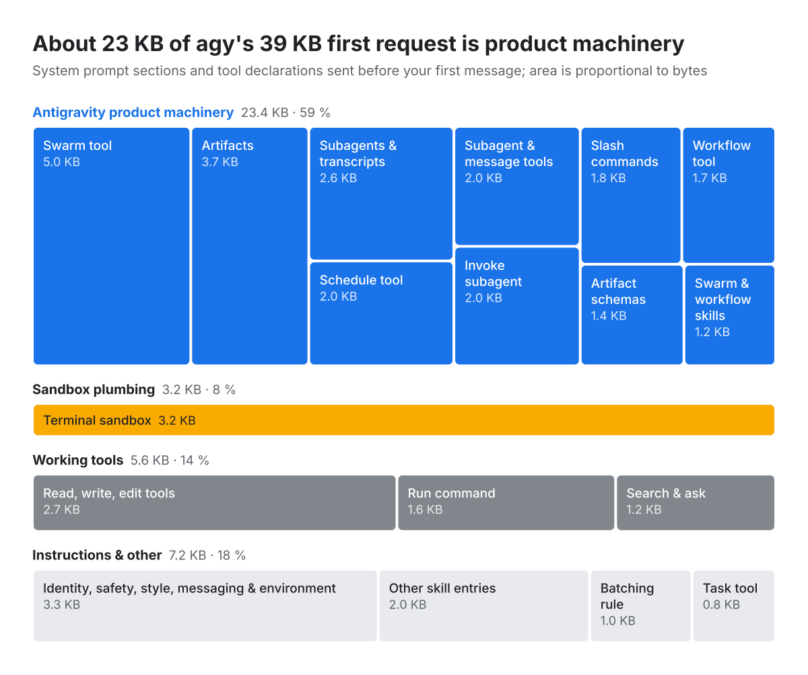
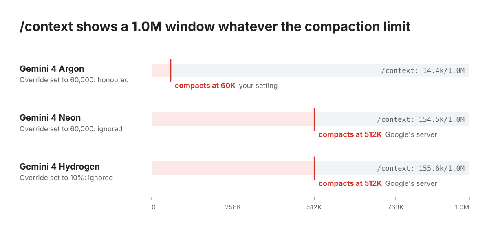

# What `agy` sends the model: system prompt, tools, injected messages and compaction

Every main-agent request in `agy` 1.5.14 carries a 19 KB system prompt and 20 KB of tool declarations before the first word the user types. About two thirds of the prompt describes Antigravity's own features. Its behavioural rules are two prohibitions plus advice on batching tool calls. The client also adds text of its own to the conversation, and on long sessions it replaces the whole history with a summary the model writes.

## The main system prompt has 12 sections, and 65 % of it is about Antigravity

The captured system instruction of the main agent on Gemini 4 Neon is 18,967 bytes in twelve XML-tagged sections, joined by single newlines ([main-agent.txt](../../resources/cli/system-prompts/main-agent.txt); every captured prompt is listed in [the index](../../resources/cli/system-prompts/INDEX.md)). The sizes below are bytes of each section, tags included.

| Section | Bytes | What it says |
|---|---:|---|
| `identity` | 295 | "You are Antigravity, a powerful agentic AI assistant designed by the Google Deepmind team"; user requests arrive in `<USER_REQUEST>` tags |
| `terminal_sandbox` | 3,225 | What the sandbox allows, when to set `BypassSandbox`, and command shapes that keep "always allow" approvals prefix-matchable |
| `artifacts` | 3,709 | Antigravity's markdown reports: when to write one, GitHub alerts, supported Mermaid types, carousels, the scratch folder |
| `conversation_transcript` | 494 | Where the agent's own `transcript.jsonl` and `transcript_full.jsonl` live |
| `guidelines` | 1,094 | Two prohibitions (below) |
| `work_efficiently` | 988 | Batch independent reads, searches and edits in one turn (new in 1.5.14) |
| `communication_style` | 507 | Be concise, use markdown, ask when unsure, link every file with `file://` |
| `slash_commands` | 1,838 | Nine slash commands the model should recommend, "encouraging the user to explore and trigger them" |
| `messaging` | 878 | Messages from agents, background tasks and queued user input wake the agent; no polling |
| `subagents` | 2,067 | `invoke_subagent`, `define_subagent`, `send_message`, and the three built-in helpers |
| `skills` | 3,294 | What a skill is and the list of available skills with their paths |
| `user_information` | 567 | OS, workspace, app data folder, conversation ID, artifact folder |

Artifacts, transcripts, slash commands, messaging, subagents and skills add up to 12,280 bytes, 65 % of the prompt. The sandbox section is 17 %, identity and environment 5 %. What is left for how to do the work is `guidelines`, `work_efficiently` and `communication_style`: 2,589 bytes, 14 %.

The `<guidelines>` section opens "Follow these behavioral guidelines at all times:" and then holds two rules. One forbids defeating "an access control, permission check, credential requirement, network/proxy restriction, or sandbox/environment boundary" and ends "if none of them work, you are blocked - report the error and stop". The other forbids solving or bypassing a CAPTCHA or anti-bot challenge. Nothing in the prompt covers reading code before changing it, keeping to the project's style, testing, or reporting results truthfully.

The `slash_commands` section tells the model "You cannot execute these commands yourself. Your role is to recommend them to the user", then lists `/goal`, `/compact`, `/schedule`, `/browser`, `/plan`, `/grill-me`, `/teamwork`, `/learn` and `/boost`, each with a "Recommend this when…" line.

Evidence:
- Prompt text: [main-agent.txt](../../resources/cli/system-prompts/main-agent.txt), captured from a 1.5.14 request
- Prompt text: section templates [identity.tmpl](../../resources/cli/binary-1.5.14/system_sections/identity.tmpl), [slash_commands.tmpl](../../resources/cli/binary-1.5.14/system_sections/slash_commands.tmpl), [subagents.txt](../../resources/cli/binary-1.5.14/system_sections/subagents.txt), [skills.tmpl](../../resources/cli/binary-1.5.14/system_sections/skills.tmpl), [work_efficiently.txt](../../resources/cli/binary-1.5.14/system_sections/work_efficiently.txt), [guidelines.tmpl](../../resources/cli/binary-1.5.14/system_sections/guidelines.tmpl)
- Binary: `jetski/cortex/mixins.(*WorkEfficientlySection).ShouldInclude` decides whether `<work_efficiently>` is added
- Server: [`invoke-subagent-config`](../../resources/cli/server-switches/INDEX.md#invoke-subagent-config) switches on the subagent sections

## Only Gemini 4 Hydrogen gets rules about code quality and honest answers

On Gemini 4 Hydrogen the prompt is 22,262 bytes. The difference is entirely in `<guidelines>`, which grows from 1,094 to 4,389 bytes with three subsections: `efficient_code_reading` ("Locate before reading", read ranges "usually under 150 lines"), `code_quality` ("A senior reviewer will read your final diff"; "Never duplicate logic"; "Reuse the repo's existing helpers") and `final_answer_accuracy` ("Never lie in your final answer: never state as fact anything you did not see in this session's files or tool output").

The client template decides which of these to render from the prompt sections in the model's configuration. The server's model list sends a replacement guidelines template, `template__system_prompts__guidelines`, for the six Hydrogen variants and `gemini-flash-worker-agy` only. Neon, Argon, Gemini 3.8 Flash, Claude and GPT-OSS run with the two prohibitions.

Evidence:
- Prompt text: [main-agent-gemini-4-hydrogen.txt](../../resources/cli/system-prompts/main-agent-gemini-4-hydrogen.txt), captured from a 1.5.14 request
- Prompt text: [guidelines-332984e3.tmpl](../../resources/cli/binary-1.5.14/configuration/model-templates/guidelines-332984e3.tmpl) checks for `efficient_code_reading`, `code_quality` and `final_answer_accuracy` sections
- Server: [`template__system_prompts__guidelines`](../../resources/cli/server-switches/INDEX.md#template__system_prompts__guidelines), present for 7 models in [available-models.json](../../resources/cli/server-switches/available-models.json)

## Fourteen tools, 20 KB of declarations, a quarter of it the swarm and scheduler

The main agent gets 14 function declarations. As one compact JSON array they are 20,426 bytes; the descriptions are 6,840 bytes of that, and the rest is parameter schemas.

| Tool | Bytes | Tool | Bytes |
|---|---:|---|---:|
| `swarm` | 4,977 | `ask_question` | 871 |
| `schedule` | 1,996 | `manage_task` | 794 |
| `invoke_subagent` | 1,981 | `read_file` | 714 |
| `edit_file` | 1,801 | `manage_subagents` | 690 |
| `run_workflow` | 1,698 | `send_message` | 397 |
| `run_command` | 1,646 | `search_web` | 333 |
| `write_file` | 1,612 | `define_subagent` | 901 |

The largest declaration is for a tool the description itself says not to use: `swarm` begins "ONLY call this tool when the user explicitly invoked `/swarm`, a skill you read explicitly instructs you to call it, or this conversation already has an active swarm. NEVER start or inspect a swarm on your own". It is sent on every request anyway. `write_file` and `edit_file` each carry an `ArtifactMetadata` schema (683 and 700 bytes) for Antigravity's artifact files.

There is no tool to list a directory or search file contents; those go through `run_command`. `read_file` states its limits ("at most 800 lines or 46080 bytes"), and `run_command` says commands run in a new session each time and move to the background after `WaitMsBeforeAsync`.

What the descriptions leave out:
- None of them says a call can be held for review. In the default mode, file writes, edits, most commands and helper launches are sent with the session history to Google's review models before they run ([safety-reviews.md](safety-reviews.md)).
- `run_command` doesn't say the sandbox has no network; only the system prompt does. `BypassSandbox` says only that it "requires elevated user permission for auth exchange, network, or port binding".
- `send_message` doesn't say how a reply arrives. Replies and helper reports come back as `<SYSTEM_MESSAGE>` blocks marked `MESSAGE_PRIORITY_HIGH` (next section).
- `invoke_subagent` takes a `TypeName` without listing the types; the list (`self`, `research`, `image-generator`) is in the system prompt.
- `schedule` doesn't say what happens with a cron expression that never matches. One for 31 February fired three times in 29 seconds ([agents-and-swarm.md](agents-and-swarm.md#schedule-wakes-the-agent-with-each-tick)).

Evidence:
- Tool declarations: [main-agent.json](../../resources/cli/tool-declarations/main-agent.json) ([index](../../resources/cli/tool-declarations/INDEX.md)), captured from a 1.5.14 request
- Prompt text: [swarm.rendered.txt](../../resources/cli/binary-1.5.14/tool_descriptions/core/swarm.rendered.txt), [schedule.txt](../../resources/cli/binary-1.5.14/tool_descriptions/core/schedule.txt), [invoke_subagent-d9463bae.txt](../../resources/cli/binary-1.5.14/tool_descriptions/invoke_subagent-d9463bae.txt)

## The first request is 39 KB, and 23 KB of it is product machinery

The system prompt and declarations together are about 39 KB before the user's message. The treemap groups them by purpose: 23.4 KB (59 %) is Antigravity's own machinery (the swarm, schedule, subagent and workflow tools, artifacts and their schemas, slash commands, transcripts, and the swarm and workflow skill entries), 3.2 KB is sandbox plumbing, 5.6 KB is the working tools (read, write, edit, run, search, ask) and 7.2 KB is identity, rules, style, environment and the other skill entries.

In tokens, the first main-agent request with a one-sentence prompt counted 9,413 prompt tokens on Gemini 4 Argon (`usageMetadata.promptTokenCount`). The same prompt and tools are re-sent on every turn.

Evidence:
- Diagram: [first-request.svg](../../resources/diagrams/first-request.svg)
- Traffic: [request layout](../../resources/cli/protocol/wire-model-request.md); [compaction sequence](../../resources/cli/traffic/compaction.md) (first row, 9,413 tokens)

## The client writes into the conversation as `<SYSTEM_MESSAGE>`

Text that doesn't come from the user or a tool still arrives in user entries or appended to tool results, wrapped in a fixed sentence: "The following is a <SYSTEM_MESSAGE> not actually sent by the user. It is provided by the system as important information to pay attention to." Inside, each item is a `[Message]` line with `timestamp`, `sender` (a conversation ID, or `<conversation>/task-N` for a timer) and `priority=MESSAGE_PRIORITY_HIGH`. This carries:
- a helper's brief (in the helper's conversation) and its report (in the caller's);
- every `schedule` tick, for example "[monitor] tick: check the swarm for a stall (iteration 1)";
- swarm board notifications ("[swarm] new board message #5") and a swarm member's assignment;
- the batching reminder new in 1.5.14, "Reminder: work efficiently. In this turn, issue in parallel every independent search, read and edit or write you need next. Never one call per turn…", appended to a tool result after a turn with a single tool call.

A report that arrives while the agent is busy is appended to whatever tool result comes next, so a helper's summary can appear inside the output of an unrelated failed command.

The user's own message gets other wrappers. The prompt is inside `<USER_REQUEST>`, followed by `<ADDITIONAL_METADATA>` with the local time, and on the first turn `<USER_SETTINGS_CHANGE>` reporting the model selection with "No need to comment on this change if the user doesn't ask about it". A slash command that maps to a skill puts the skill's whole text inside `<ADDITIONAL_METADATA>`: `/swarm` adds the 20 KB coordinator skill under "The user has explicitly invoked the (swarm) skill. You must strictly follow the instructions in this skill".

Evidence:
- Traffic: [injected messages in 1.5.14 requests](../../resources/cli/traffic/injected-messages.md); [wrappers and helper briefs](../../resources/cli/traffic/injections.md)
- Prompt text: [system-wrapper.txt](../../resources/cli/binary-1.5.14/message_templates/system-wrapper.txt), [ephemeral-wrapper.txt](../../resources/cli/binary-1.5.14/message_templates/ephemeral-wrapper.txt), [user-input.txt](../../resources/cli/binary-1.5.14/message_templates/user-input.txt), [settings-change.txt](../../resources/cli/binary-1.5.14/message_templates/settings-change.txt), [model-change-suffix.txt](../../resources/cli/binary-1.5.14/message_templates/model-change-suffix.txt), [work-efficiently-reminder.txt](../../resources/cli/binary-1.5.14/message_templates/work-efficiently-reminder.txt)
- Binary: `jetski/cortex/core/prehooks.isSingleToolCallTurn` is the check behind the batching reminder

## Sixteen built-in skills ship in the binary; the prompt lists five

The binary carries 16 built-in skills, extracted to `~/.gemini/antigravity-cli/builtin/skills/`. The captured main-agent prompt lists five of them by path: `agy-customizations`, `antigravity-guide`, `run-workflow`, `swarm_monitor` and `swarm_pane`. The model reads a skill with `read_file` when its description fits ("If a skill seems relevant to your current task, you MUST read its `SKILL.md` instructions before proceeding").

Two front-matter flags change how a skill is reached. `disable-model-invocation: true` (only the swarm skill) keeps it out of the model's list, so it runs only when the user types `/swarm`. `disable-slash-command: true` (`conversations`, `swarm_monitor`, `swarm_narrator`, `swarm_pane`, `ui-plugin-navigation`) hides it from the slash menu, so only the model can load it. The two swarm entries in the prompt are each a line telling every agent except one not to load it: "Coordinators and other workers: do not load this."

The `generative_ui` skill tells the model to build widgets with "Tailwind CSS and inline JavaScript" and allows "one allowlisted gstatic Tailwind dependency", while the web-development system section says "Avoid using TailwindCSS unless the USER explicitly requests it".

Evidence:
- Prompt text: [binary index, built-in skills](../../resources/cli/binary-1.5.14/INDEX.md#built-in-skills); [native_swarm/SKILL.md](../../resources/cli/binary-1.5.14/skills/native_swarm/SKILL.md) (front matter), [swarm_monitor/SKILL.md](../../resources/cli/binary-1.5.14/skills/swarm_monitor/SKILL.md), [generative_ui/SKILL.md](../../resources/cli/binary-1.5.14/skills/generative_ui/SKILL.md), [web_application_development.txt](../../resources/cli/binary-1.5.14/system_sections/web_application_development.txt)
- Traffic: [/swarm putting the skill into the user entry](../../resources/cli/traffic/injected-messages.md)

## Compaction replaces the history with a summary the same model writes

Compaction settings come per model from the server, in `CASCADE_USE_EXPERIMENT_CHECKPOINTER` in the `fetchAvailableModels` response:

| Models | `strategy` | `max_token_limit` | Summary prompt |
|---|---|---:|---|
| Gemini 4 Neon, Argon, Carbon; Orchestrator | `SAME_MODEL` | 512,000 | server text identical to the built-in default |
| Gemini 4 Hydrogen, `gemini-flash-worker-agy` | `SAME_MODEL` | 512,000 | server text with eight sections and resume rules |
| Gemini 3.8 Flash | `SAME_MODEL` | 256,000 | built-in default |
| Claude Opus 5.5, Sonnet 5.5 | `SAME_MODEL` | 256,000 | built-in default |
| Gemini 2.5, 3 and 3.5 models | `SINGLE_PROMPT` | 128,000 | built-in default |
| GPT-OSS 120B | `UNSPECIFIED` | 80,000 | built-in default |

All entries also carry `token_threshold: 50000`, `max_overhead_ratio: 0.15` and `max_user_requests: 10`.

The limit is checked after a step, not before it. In a captured session on Gemini 4 Argon with a 60,000 limit, six parallel file reads in one step took the history to 86,073 prompt tokens. The client then sent a `checkpoint` request: the main agent's system prompt and 14 tools, the whole history, and as the last entry the summary prompt, with `maxOutputTokens: 32768`. The model answered in 588 tokens. The next agent request held one entry of 10,043 tokens: a `<CONTEXT_SUMMARY>` with the last user requests, the summary, and pointers to the transcript files for detail. The same happened again on the next prompt (86,843 tokens, then 10,184).

The built-in summary prompt (3,937 bytes) starts "You have been working on the task described above but have not yet completed it. Write a continuation summary…" and asks for seven sections: Task Overview, Progress, Key Findings, Errors & Fixes, Active Context, Next Steps, Commitments & Constraints. The Hydrogen version (6,307 bytes) replaces them with eight (Done, Files Already Read and Code Map among them), makes the summary start "RESUMING MY OWN TASK IN PROGRESS", and ends it with "RESUME RULES" in the first person, such as "While Next Steps remain, I do not open any file or range listed in Files Already Read or the Code Map" and "Never lie. I can no longer see the code or tool outputs from before this summary". `/compact` adds "ON-DEMAND COMPACTION: The user triggered this compaction."

The user can change the limit only on Gemini 4 Argon. `AGY_CLI_AUTO_COMPACT_OVERRIDE` (a token count or a percentage) is honoured there: trajectory uploads show `maxTokenLimit: 60000`, or 104,857 for `10%` (10 % of 2^20). On Gemini 4 Neon and Hydrogen the variable is ignored and the server's 512,000 stays; a Neon session reached 161,445 prompt tokens without compacting. `/context` shows a 1.0M window for all three models, whatever limit is in force.

Evidence:
- Traffic: [compaction requests and limits](../../resources/cli/traffic/compaction.md); [checkpoint request layout](../../resources/cli/protocol/wire-side-model-requests.md#compaction)
- Prompt text: [default.txt](../../resources/cli/binary-1.5.14/compaction/default.txt), [session-summary-75de66ce.txt](../../resources/cli/binary-1.5.14/compaction/overrides/session-summary-75de66ce.txt), [on-demand.txt](../../resources/cli/binary-1.5.14/compaction/on-demand.txt), [continuation.txt](../../resources/cli/binary-1.5.14/compaction/continuation.txt)
- Server: [`CASCADE_USE_EXPERIMENT_CHECKPOINTER`](../../resources/cli/server-switches/INDEX.md#CASCADE_USE_EXPERIMENT_CHECKPOINTER), per model in [available-models.json](../../resources/cli/server-switches/available-models.json); [`enable-compact-slash-command`](../../resources/cli/server-switches/INDEX.md#enable-compact-slash-command)
- Binary: `jetski/cortex/config.applyFeatureProviderCheckpointOverrideConfig` merges the server's checkpoint config over the built-in default; `jetski/cortex/config.MergeCascadeConfigsWithOverwrites` then merges the client's request config, which carries the Argon override, last. `/context` is computed separately, in `jetski/cortex/agent_state_component.computeContextWindowUsage`
- Diagram: [compaction.svg](../../resources/diagrams/compaction.svg)
