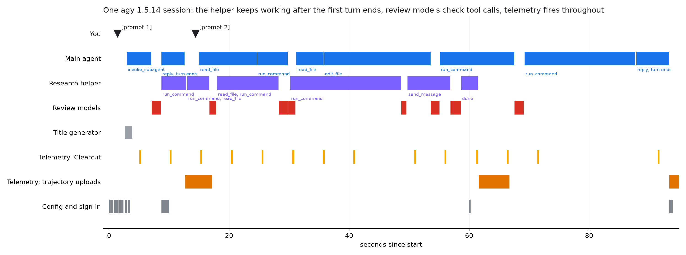
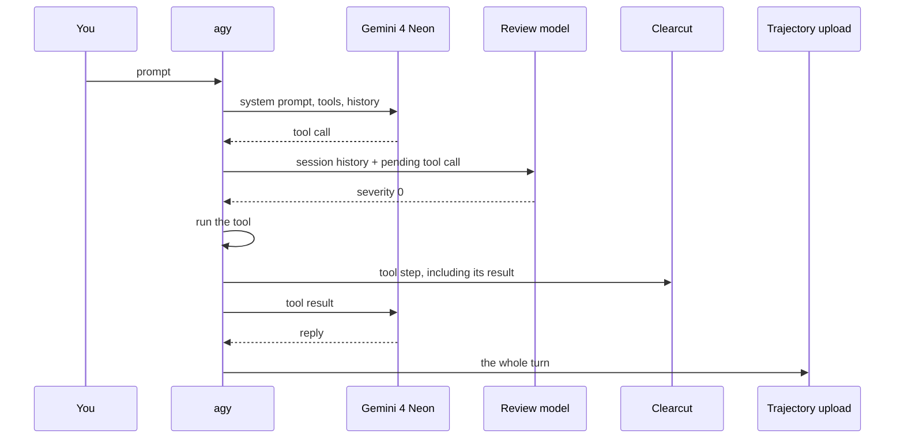

# One `agy` 1.5.14 session

Two prompts to Gemini 4 Neon (Medium) in a small Python project, with default settings. The first asks the research helper to explore the project and summarize it; the second asks for a `discount(total, pct)` function and `git diff --stat`.

- **The helper outlives the turn.** The main agent delegates, then ends its first turn at 12.6 s with the helper still running. The helper keeps working until 61.5 s, through the whole second turn, and reports back with `send_message`.
- **Review models check tool calls.** Eight requests go to Gemini 3.5 Flash-Lite with the session and the pending tool call before the call runs. All eight returned severity 0.
- **Telemetry outweighs the work.** The agent's own model requests sent 0.54 MB. Clearcut sent 2.12 MB in 15 batches, every one containing `file:///` URIs, and three trajectory uploads sent another 0.62 MB.

## One turn, simplified

## Files

| File | Contents |
|---|---|
| `trace.jsonl` | One line per request: seconds since start, duration, endpoint, bytes sent and received, and a few fields per request type (model, tool names and arguments, review verdicts, how many `file:///` URIs a Clearcut batch held) |
| `timeline.json` | The same events as a Chrome trace. Open [ui.perfetto.dev](https://ui.perfetto.dev) and drag the file in to zoom, pan and click any request |
| `timeline.png` | The first 95 seconds of the timeline |
