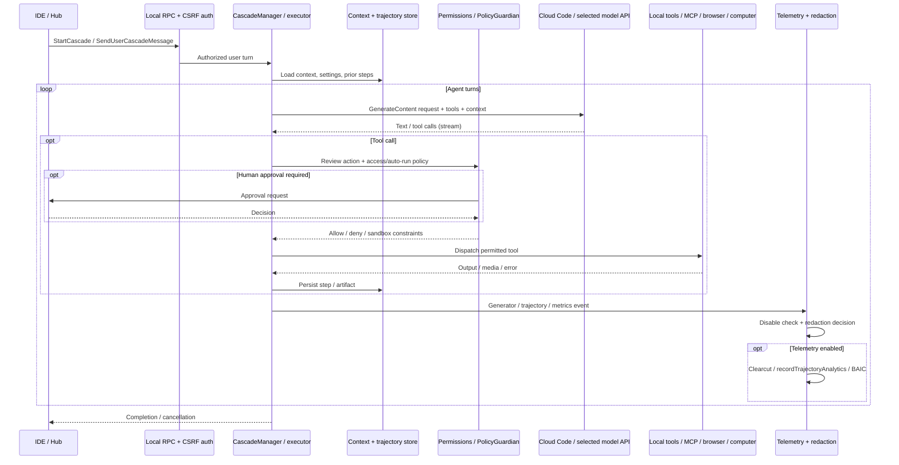

# Antigravity language_server: static privacy and security assessment

## Scope

Static analysis of `language_server`, the macOS arm64 agent backend bundled with Antigravity 2.33.0 (193,844,912 bytes, SHA-256 `59f20c05e424a13a04d0a93c342e06ec61155b87fa040a5a280bab240ba8348b`). Offsets are original file offsets unless marked as virtual addresses (VA).

## Executive findings

1. This is a substantial remote-model agent, not just a local language server. Cloud Code model generation, a separate AICode route, Business AI Code, configurable gateways, local terminal/file tools, browser/computer control, subagents and scheduled work are compiled in.
2. There are **distinct content-bearing telemetry paths**: Clearcut (`play.googleapis.com/log`) and `recordTrajectoryAnalytics` through the Jetski backend. The telemetry envelope supports entire trajectory steps and generator metadata, including user input, file/tool output and prompt-debug content through nested messages. This is materially broader than anonymous crash counters.
3. There are real telemetry-disable and user-data redaction controls. They are not equivalent to preventing model-service processing or disabling all networking. Static evidence does **not** establish a universal opt-out bypass.
4. **Medium: trajectory file encryption uses a hard-coded shared AES-GCM key.** The key is copied straight from the binary into both ordinary and implicit trajectory savers. It does not provide confidentiality against anyone who can obtain both the application and saved files.
5. **Medium: an overbroad localhost TLS exception can disable certificate verification for non-local endpoints.** It searches for the substring `https://localhost`, including in any of eight override environment variables, and feeds that result into the shared Cloud Code transport's `tls.Config.InsecureSkipVerify`.
6. **Low: OAuth/plugin credential file fallbacks are unencrypted.** Restrictive directory/temp-file permissions reduce exposure; they are not equivalent to Keychain protection.
7. No confirmed unauthenticated RCE, sandbox escape, or Critical/High security vulnerability was established. The command sandbox, CSRF interceptor, scoped tokens, origin/host checks and PolicyGuardian are substantive controls, but static presence is not a proof of their end-to-end effectiveness.

## 1. Extraction products and package map

`go tool nm` exposed principally native imports, not the internal Go symbol set. Parsing Go's embedded `pclntab` recovered **191,674 function entries**. `canonical-packages.tsv` contains **2,779 syntactically canonical `google3/...` package-like prefixes**; this count includes generated protobuf/dependency packages and is not a count of product subsystems. Generic-instantiation names are preserved in `functions.tsv`/`packages.tsv` rather than treated as additional product components.

Prefix abbreviations: **J** = `google3/third_party/jetski/`; **D** = `google3/devtools/jetski/`; **G** = `google3/third_party/gemini_coder/`; **O** = `google3/third_party/oneharness/`.

| Subsystem | Representative embedded package paths | Interpretation/evidence |
|---|---|---|
| Cascade orchestration | `J/cortex/cortex`, `J/cortex/cascade_run_state/cascade_run_state`, `J/cortex/agentmanager/agentmanager`, `J/cortex/agent_state_component/agent_state_component` | `CascadeManager`, `ordinaryExecutor.Run`, `sdkExecutor.Run`, background runners |
| Agent/model loop | `G/framework/agent/agent`, `G/framework/executor/agentexecutor/agentexecutor`, `G/framework/generator/generator`, `J/cortex/core/planexecute/planexecute`, `J/cortex/core/native_swarm/nativeswarm` | Multiple executors, planning mode, native swarm coordination |
| Tool adapters | `J/cortex/tools/tools`, `J/cortex/tools/code/code`, `J/cortex/tools/notebook/notebook`, `J/cortex/tools/subagent/subagent`, `G/framework/toolconverters/toolconverters`, `O/internal/tools/tools` | Schema construction and conversion to trajectory steps; both newer and older tool families coexist |
| Terminal sandbox | `J/cortex/command/command`, `J/cortex/command/sandboxproxy/sandboxproxy`, `J/cortex/command/sandboxproxy/credentialkey/credentialkey` | Sandbox preparation, connectd proxy, credential handles |
| Permissions/safety | `J/cortex/autorun/autorun`, `J/cortex/policyguardian/policyguardian`, `J/cortex/policyguardian/fastpath/fastpath`, `J/cortex/policyguardian/deterministic_vetting_configs/deterministic_vetting_configs`, `J/cortex/ext/plugins/shared/actuatorsandbox/actuatorsandbox` | Auto-run rules, deterministic and model-assisted policy review |
| Cloud model/auth clients | `J/language_server/code_assist_client/codeassistclient`, `J/language_server/auth_client/authclient`, `J/cortex/utils/authstore/authstore`, `J/cortex/utils/mcp/oauth/oauth` | Cloud Code, Business AICode, AICode, OAuth, gateway/host/CLI auth providers |
| Analytics | `D/telemetry/client/telemetryclient`, `J/language_server/telemetry/telemetry`, `J/telemetryutil/telemetryutil`, `google3/wireless/android/play/playlog/go/clearcut` | Clearcut transport, nested trajectory analytics, schema redaction |
| Identifiers | `J/language_server/metadata_provider/metadata_provider`, `J/language_server/installationid/installationid`, `J/language_server/hostclientidentity/hostclientidentity` | Shared request metadata, IDE installation ID, host-client identity |
| Conversation persistence | `J/cortex/proto_saver/proto_saver`, `J/cortex/trajectory/dbtrajectory/dbtrajectory`, `J/cortex/trajectory_store/trajectorystore`, `J/language_server/conversationsearch/conversationsearch` | Encrypted protobuf saver, separate SQLite backend, searchable conversation history |
| Artifacts/knowledge | `J/cortex/artifacts/artifacts`, `J/cortex/artifacts/trajectorylog/trajectorylog`, `J/cortex/context_module_pb/context_module_go_proto`, `learning/gemini/agents/projects/memory/...` descriptor families | Artifacts and memory/knowledge context are supported; inclusion of a memory descriptor alone does not establish an active remote memory service |
| Indexing | `J/index_pb/index_go_proto`, `J/language_server/radix/radix`, `J/language_server/projects/projects`, `J/gitignore/gitignore` | Local workspace/search representation, SCM and ignore handling |
| Sync | `J/language_server/state_sync/statesync`, `J/unified_state_sync_pb/unified_state_sync_go_proto`, `J/language_server/jetbox_state_store/jetbox_state_store` | Shared/settings state and conversation summaries; not proof of full conversation cloud sync |
| MCP | `J/cortex/utils/mcp/mcp`, `J/cortex/utils/mcp/mcpcore/mcpcore`, `J/cortex/utils/mcp/oauth/oauth`, `J/cortex/core/tools/tools` | MCP server connections, OAuth, resources, tool discovery/calls and app integration |
| Browser/computer | `J/cortex/ext/plugins/browser/browser`, `J/cortex/ext/plugins/computer/computer`, `J/webview_browser_pb/webview_browser_go_proto` | Webview browser actions, desktop tools, gated host interface, artifacts/media |
| Local RPC/server | `J/language_server/language_server`, `J/language_server/interceptor/interceptor`, `J/language_server/backend/local/local` | HTTP and HTTPS/gRPC ports, CSRF/scoped authorization, origin normalization |

Supporting inventories: `functions.tsv`, `canonical-packages.tsv`, `cortex-packages.tsv`, `tool-converter-symbols.txt`. Package names are recovered compiler strings, not guessed source tree locations.

## 2. Network endpoint and RPC inventory

The extracted inventories contain 359 broad URL matches, 101 host-like matches and 1,057 service-method records decoded from protobuf descriptors (`rpcs-descriptors.tsv`). `rpcs.tsv` also captures literal RPC paths. Raw regex inventories contain concatenation artifacts and library/example URLs; they are **not** an allowlist of destinations actually contacted. `exact-network-literals.tsv` is the conservative recovered Go string-literal list. The table separates executable client evidence from descriptor-only capability.

| Host / endpoint | Purpose and method family | Evidence / confidence |
|---|---|---|
| `https://cloudcode-pa.googleapis.com` | Main Cloud Code/CCPA route; `generateContent`, `streamGenerateContent`; `/google.internal.cloud.code.v1internal.CloudCode/...` includes `StreamGenerateChat`, `LoadCodeAssist`, `RecordCodeAssistMetrics`, `RecordClientEvent`, user settings | Host at `0x3530467`; `codeassistclient.BuildGenerateContentRequest` at `0x2212e20`, `.streamGenerateContentFromCCPA` at `0x2214880`, `.StreamGenerateContent` at `0x22140d0`; CloudCode descriptor at `0x35932bc`. Request builders and transport exist, not just a URL string |
| Jetski service under configured Cloud Code/AICode base | `/google.internal.cloud.code.v1internal.JetskiService/RecordTrajectoryAnalytics`, `WriteTrajectoryACLs`, `FetchUserInfo`, `SetUserSettings`, `CheckUrlDenylist`, `CheckUrlAntivirus`, `RegisterInteraction`, `UploadPerformanceProfile`, `ProvisionConversationBundleDir`, `GetBundleWriteMint` | Descriptor `google__internal__cloud__code__v1internal__jetski_service.proto.proto`; `.RecordTrajectorySegmentAnalytics` at `0x2231080` calls `SkipTelemetry`, marshals trajectory and metadata, and posts method `recordTrajectoryAnalytics` (`0x34cfb75`). `.jetskiServiceEndpointURL` at `0x221b1d0` supports `JETSKI_SERVICE_ENDPOINT_URL`. [INFERENCE] normal deployed base follows selected Cloud Code/AICode route |
| `https://aicode.googleapis.com` | Alternative AICode prediction/service route | `.aicodeBaseURL` at `0x221b080` returns URL literal at `0x34fd281`; `.StreamGenerateContentFromAICode`, `.GenerateContentFromAICode`, `.AICodeGRPCEndpoint` present |
| `businessaicode.googleapis.com` / configured regional BAIC host | Business/enterprise model prediction and `sendTelemetry` | `google.cloud.businessaicode.v1beta.TelemetryService`; `.getBusinessAICodeURL` at `0x21fe2b0`, `.SendBAICTelemetry` at `0x2200ed0` constructs `sendTelemetry` resource URL. Overrides `BAICODE_ENDPOINT_URL`, `BAICODE_PREDICTION_ENDPOINT_URL`, `BAICODE_MANAGEMENT_ENDPOINT_URL`, `BAICODE_TELEMETRY_ENDPOINT_URL`. Exact per-account host/region not statically fixed |
| `https://play.googleapis.com/log` | Clearcut analytics sink, including `JetskiTelemetryExtension` payloads | Exact literal at `0x350f58d`; `telemetryclient.(*AntigravityClient).NewClearcutClient` at `0x293ea50` calls `clearcut.NewWithOptions` at VA `0x10293eb08` |
| `https://daily-cloudcode-pa.googleapis.com`, `autopush-cloudcode-pa.sandbox.googleapis.com`, `preprod-daily-cloudcode-pa.sandbox.googleapis.com`, `autopush-aicode.sandbox.googleapis.com`, `preprod-aicode.sandbox.googleapis.com` | Development/staging alternatives | Strings at `0x3557a25`, `0x358e30d`, `0x35a144f`, `0x3573a31`, `0x356e27c`; selection/mapping functions exist. Presence is not evidence production accounts use these |
| `https://generativelanguage.googleapis.com` | Gemini API-key alternative, `.../v1beta/models/%s:generateContent`; streaming variant also embedded | Literal at `0x355890a`; `GeminiAPIKeyAuthProvider` and model client/converter symbols |
| `aiplatform.googleapis.com`, `https://%s-aiplatform.googleapis.com/` | Vertex/region-scoped alternative model API, publisher model routes | Host/template strings and Vertex client functions. Activation depends on provider/config |
| Configured gateway | OpenAI-compatible `/v1/chat/completions`, other model adapters | `.StreamGenerateContentFromGateway`, `.GenerateContentFromGateway`, `AGY_LLM_GATEWAY_PROXY_URL`, `AGY_LLM_GATEWAY_CA_CERT`; Anthropic/OpenAI conversion code. No fixed third-party model host can be inferred from the adapter alone |
| `oauth2.googleapis.com/token`, `/device/code`; `accounts.google.com/o/oauth2/auth`; `auth.cloud.google/authorize` | OAuth login, refresh, device authorization | Exact literals at `0x3532672`, `0x3559841`, `0x3559818`, `0x3530421`; compiled scopes include `userinfo.email`, `userinfo.profile`, `cloud-platform`, `aicode`, `cclog`, `experimentsandconfigs`. Scopes present are not necessarily all granted in one flow |
| `api.github.com`, `/graphql`, `github.com/login/...` | GitHub integration/device/OAuth | Literal offsets `0x34b0ffe`, `0x350857d`, `0x353c972`, `0x3555ef0`, `0x3567469` |
| `www.googleapis.com/drive/v3/`, `sts.googleapis.com/v1/oauthtoken`, `api.deps.dev/v3alpha`, `modelarmor.googleapis.com` | Drive, workload identity/STS, dependency information, model armor clients/descriptors | Embedded library/provider capability; do not equate with baseline traffic |
| `localhost`/loopback, optional `0.0.0.0` | Local IDE/Hub/backend RPC, browser/devtools/extension ports | `language_server.setUpServerPortListeners` at `0x2c2ef30` creates HTTP and HTTPS/gRPC listeners; dynamic flags `http_server_port`, `https_server_port`, `lsp_port`, `extension_server_port`, `remote_accessible` |

Additional legacy/local service families: `exa.language_server_pb.LanguageServerService`, `exa.api_server_pb.ApiServerService`, `exa.conversation_pb.ConversationService`, `exa.opensearch_clients_pb.*`, `exa.seat_management_pb.SeatManagementService`. The language server descriptor exposes `StartCascade`, `SendUserCascadeMessage`, conversation/trajectory retrieval, permission/settings updates, SCM state and related methods. The legacy ApiServer descriptor includes `GetEmbeddings`, chat/completions, upload/trajectory-share functionality. These are schemas compiled into the program, not proof a legacy Codeium host is currently used.

**Sentry:** the substring `sentry.io` occurs in a large concatenated string block, but this analysis did not identify an active Sentry DSN/initialization or a routed crash upload to Sentry. Do not list it as a confirmed sink. `crashreporter.UploadPreviousCrashes` is compiled in; its actual selected destination was not resolved here.

**OAuth client secrets:** multiple `GOCSPX-...` public-installed-client literals occur near Google OAuth configuration (for example `0x3530442`). Embedded installed-app OAuth secrets should not be treated as server credential compromise without evidence that Google authorizes privileged confidential-client operations based on them alone. They are not reproduced as operational credentials.

## 3. Extracted protobufs: exact content-bearing telemetry

The decoder scans candidate serialized `FileDescriptorProto` records beginning with `.proto` filenames, walks protobuf top-level fields, validates decoded descriptors and writes original wire bytes plus `.textproto` and readable `.proto` renderings. **548 descriptors were recovered**. `descriptor_manifest.json` maps every recovered descriptor to its original offset and length. This is a successful-descriptor inventory, not a guarantee that every descriptor uses this recoverable layout.

The readable `.proto` renderings intentionally omit custom options and are inspection aids, not recompilable source (notably `syntax = "editions"` and rendered map/oneof details). Raw `.pb` files retain original options; `.textproto` displays recognized fields but cannot interpret extensions that were not registered. Therefore privacy semantic annotations are evidence of a redaction mechanism, not a basis here for claiming all sensitive fields are correctly tagged.

### Clearcut envelope

`devtools/jetski/telemetry/telemetry.proto`, original offset `0x3754c83`, 5,183 bytes:

```proto
message JetskiTelemetryExtension {
  string ide_name = 16;
  string ide_version = 17;
  string os = 18;
  string arch = 19;
  uint64 hashed_gaia_id = 20;
  string user_tier_id = 22;
  repeated string user_tags = 23;
  bool is_redacted = 24;
  string region_code = 25;
  string product_name = 27;
  string outer_app_version = 31;
  string host_identifier = 34;
  repeated string enabled_labs_features = 35;
  ExperimentConfig experiment_config = 36;
  // oneof payload includes:
  CortexGeneratorMetadata cortex_generator_metadata = 3;
  TrajectorySegmentAnalyticsMetadata trajectory_segment_analytics_metadata = 9;
  TrajectorySegmentEventsMetadata trajectory_segment_events_metadata = 10;
  CortexTrajectory cortex_trajectory = 11;
  CortexTrajectoryStep cortex_trajectory_step = 12;
  CortexMetrics cortex_metrics = 14;
  ErrorTraceMetadata error_trace_metadata = 15;
  // also completion, feedback, URL reads, RPC, monitor, hooks,
  // input completion, remote control/agent/VM event payloads.
}
```

This envelope is not anonymous: it explicitly supports account-correlated `hashed_gaia_id`, host identity, tier, tags, region and experiment assignment. Hashing the GAIA account identifier does not remove linkability by itself.

`devtools/jetski/telemetry/extensions/cortex_trajectory.proto`, `0x3681ebc`, 1,208 bytes, includes `trajectory_id`, `cascade_id`, trajectory type/source/parent references, `CortexTrajectoryMetadata`, IDE/OS names and `RedactionInfo { reason, last_retained_step_index, last_retained_generator_metadata_index, is_partially_retained }`.

`devtools/jetski/telemetry/extensions/cortex_generator_metadata.proto`, `0x3653411`, 715 bytes:

```proto
message CortexGeneratorMetadata {
  string trajectory_id = 1;
  string cascade_id = 2;
  CortexStepGeneratorMetadata generator_metadata = 3;
  uint32 metadata_index = 4;
  int32 last_common_index = 5;
  bool is_full = 6;
  string execution_id = 11;
  string plan_model = 12;
}
```

The referenced `exa.cortex_pb.CortexStepGeneratorMetadata` contains `planner_config`, `execution_id`, `error`, `mendel_experiment_ids`, **`prompt_debug_str = 9`**, and sensitivity flags. `CortexStepUserInput` contains query, user response, context-module state, file/diff/artifact comments, images/media and user identity. `CortexStepRunCommand` contains proposed and actual command lines, cwd, terminal ID, auto-run decision, stdout/stderr/combined output, sandbox flags and debug output. `CortexStepViewFile` and code-edit messages likewise carry file-related content. These nesting relationships establish that trajectory/generator telemetry has the capacity to contain prompts, code and shell output; the redaction/opt-out policy decides what is retained in an individual upload.

### Separate trajectory analytics upload

`google/internal/cloud/code/v1internal/jetski_service.proto` defines:

```proto
message RecordTrajectoryAnalyticsRequest {
  google.protobuf.Struct trajectory = 5;
  int32 start_step_index = 3;
  int32 start_generator_metadata_index = 4;
  google.protobuf.Struct metadata = 6;
  repeated int32 mendel_experiment_ids = 7;
}
message UserSettings {
  bool telemetry_enabled = 1;
  bool user_data_collection_force_disabled = 2;
  bool marketing_emails_enabled = 3;
}
message ProvisionConversationBundleDirResponse { string bundle_dir = 1; }
message GetBundleWriteMintResponse {
  string bundle_dir = 1;
  bytes bundle_write_mint = 2;
  google.protobuf.Timestamp mint_expiry_time = 3;
}
```

`.RecordTrajectorySegmentAnalytics` at `0x2231080` directly calls `.SkipTelemetry`, converts both supplied trajectory and shared metadata into Structs, and posts `recordTrajectoryAnalytics`. Wrapper `telemetry.(*Client).RecordTrajectorySegmentAnalytics` at `0x2b8f410` calls `telemetryutil.RedactOptedOutTrajectory` before this client. This is executable evidence of an upload implementation, not merely an unused RPC definition. Conversation bundle/provision/write-mint and ACL methods show additional cloud upload/sharing machinery; default use or automatic bundle uploads were not established.

### Request metadata and business telemetry

`exa.codeium_common_pb.Metadata` includes `ide_name`, `ide_version`, extension name/version/path, `locale`, `os`, `hardware`, `session_id`, **`device_fingerprint`**, `user_tier_id`, LS timestamp, trigger ID, request ID, `api_key`, `disable_telemetry`, user tags, region, product/environment and runtime/experiment configuration. See `third_party__jetski__codeium_common_pb__codeium_common.proto.proto:3316-3340`. An API key field may be an authentication credential; its presence is not proof that Clearcut receives the key unredacted.

`logs/proto/wireless/performance/mobile/desktop/antigravity_extension.proto`, `0x36b117f`, includes client type (IDE/HUB/CLI/SDK), tier, severity/error ID, backend trace IDs, and **`installation_id = 5`**. This is a distinct schema from `JetskiTelemetryExtension`; do not conflate their identifier fields.

`google/cloud/businessaicode/v1beta/telemetry_service.proto`, `0x374e773`, defines `SendTelemetryRequest { parent, repeated feedback_events, entitlement }`. Feedback carries event time, inference request ID, prompt ID and trajectory ID; resolved inference carries model/version, language, latency, trajectory-start flag, status/error, candidate counts, interaction and tool-call counts. Interaction schemas include git command/subcommand categories. This business telemetry schema is more structured than the generic full-trajectory Struct upload, not proof that all telemetry paths carry the same data.

## 4. Privacy data inventory

Destination cells below distinguish confirmed client implementation from schema-only capacity. “Unknown” means not established statically, not “no opt-out.” No retention duration or training policy is inferred from a name or a protobuf annotation.

| Data element | Source | Destination host/endpoint | Trigger | Opt-out / limitations |
|---|---|---|---|---|
| User prompt, selected code/context, conversation history, model/tool definitions and results | IDE user turn, context modules, trajectory, local files/tools | Cloud Code `generateContent`/`streamGenerateContent`; AICode/BAIC/Gemini/Vertex/gateway depending provider | Agent/model inference | Model processing is necessary for the requested remote inference; telemetry opt-out is not an offline mode |
| User-input steps, terminal commands/output, file/tool content, generator prompt-debug strings | Nested Cortex trajectory/generator messages | Jetski `recordTrajectoryAnalytics`; Clearcut payload families have schema capacity | Trajectory/step/generator recording | Disable/skip and `RedactOptedOutTrajectory`, schema sanitizer and deferred-redaction machinery exist; runtime defaults and every-field coverage unverified |
| Trajectory/cascade/execution/request/prompt IDs, timestamps, step indices | Runtime/agent/client | Both analytics paths; Business `sendTelemetry` | Generation, execution, metrics, feedback | Content redaction need not remove all linkage IDs; exact surviving fields depend sanitizer policy |
| Hashed GAIA ID | Account-associated metadata | Clearcut envelope | Telemetry recording | Explicit `hashed_gaia_id` field; hashing alone does not anonymize. Actual hash algorithm/salt not resolved |
| Host identifier | Host-client/shared metadata | Clearcut `host_identifier`; shared metadata paths | Telemetry recording | `setMetadataFields` at `0x293f130` populates envelope metadata. **Do not assume host_identifier is the literal OS hostname** |
| Device fingerprint | Client metadata provider / request metadata | Code-assist/trajectory metadata schema; `GithubClient.tokenFingerprint` is a separate credential-cache concept | API request / analytics metadata conversion | Field confirmed; algorithm, component inputs and all destinations unresolved |
| IDE installation ID | `.AntigravityIdeInstallationID`, stored IDE installation identity | Antigravity metrics extension schema; hub load/summary reconciliation callers | Store/load/reconciliation/metrics | Persistent identity support confirmed; universal transmission frequency not established |
| OS, arch, hardware, locale, IDE/extension versions and extension path | Platform/app metadata | Clearcut envelope subset; code-assist Metadata broader set | API/telemetry request | Disable/redaction controls exist; not necessarily all classified as user content |
| Email, user/team identity, profile picture, tier/tags/region | Auth / `FetchUserInfo` / UserStatus | Auth/user-info backend; telemetry includes selected tier/tags/region and hashed account identity | Sign-in/user info, requests, metrics | UserStatus explicitly has `email`; **plaintext email in every telemetry event is not proven** |
| Git repo name, owner, commit, provider, base git URL | SCM/workspace metadata (`GitRepoInfo`) | Code context / request and trajectory metadata schema | Context gathering, SCM tools or indexing | Schema proves exposure capability; not proof all git remotes are continuously uploaded |
| Absolute file paths/URIs, workspace/project/environment IDs | Context-module and trajectory workspace metadata | Model requests; trajectory telemetry as permitted | Context assembly and agent tools | Ignore/access policy can restrict gathering; metadata redaction coverage not fully decoded |
| Code/text embedding prompts | `EmbeddingsRequest.prompts`, legacy `GetEmbeddingsRequest` | Compiled ApiServer `GetEmbeddings` API; actual active backend unresolved | Embedding/indexing feature if selected [INFERENCE] | **No confirmed default whole-workspace embedding upload**. Local radix/index functionality also exists |
| URLs and fetched page content | URL read/search and browser tools | Requested websites/search provider; model context; read-URL telemetry payload | User/agent URL/browser tool | Network/URL policies and denylist/antivirus RPCs exist; specific URL-check payloads depend configuration |
| Screenshots, images/video/audio and desktop/browser observations | Browser/computer/voice tools and user attachments | Selected remote model or remote-agent path [INFERENCE]; local artifacts | When these tools/features operate | Platform permissions, gated host methods and permission policies; no evidence mic/camera always active |
| Crash/error traces, backend trace IDs and performance profiles | Crashreporter, observability/metrics | Clearcut/error envelope or configured upload service; profile RPC | Crash/error/performance collection | Not fully resolved; no active Sentry sink proven |
| MCP prompts/arguments, resource content and credentials | Configured MCP tools/resources/OAuth | User-configured MCP server; resulting content can enter remote model context | MCP discovery/resource read/tool call | Per-server/tool authorization matters; disabling Google telemetry does not disable third-party MCP disclosure |

### Opt-out interpretation

There are at least three separate concerns: model-service processing; optional telemetry; optional user-content collection/redaction. Evidence includes `disable_telemetry` flags/metadata, `UserSettings.telemetry_enabled`, `user_data_collection_force_disabled`, `.SetTelemetryLocked` -> `.startPersistTelemetryDisabled`, `.SkipTelemetry`, `.RedactOptedOutTrajectory`, and Clearcut `payloadIsOptedOut` -> `redactPayload` -> `telemetryutil.Redact`.

The deferred decision timeout log is explicitly **“Telemetry redaction decision took over %v; redacting until it returns”**, at `0x35c88f5` and `telemetryclient.resolveDeferred` (`0x2944a60`). This is positive fail-closed evidence for that decision timeout, not a finding that the program uploads raw content while waiting. It does not prove every event and every provider shares that exact gate. The `is_redacted` and `RedactionInfo` fields support reporting partial removal rather than necessarily dropping the entire event.

## 5. Agent-loop reconstruction

The following is **[INFERENCE: high-confidence architectural reconstruction]** from server/backend method names, generator/agentexecutor implementations, explicit model client builders, tool-converter dispatch and trajectory writer/telemetry call sites. It is not a captured execution trace.

1. IDE/Hub sends `StartCascade` / `SendUserCascadeMessage` to the local LanguageServerService. The interceptor validates the `x-codeium-csrf-token` and authorizes admin/scoped principals.
2. Local backend/CascadeManager locates or creates the conversation/trajectory; projects/workspace context, customizations/rules/skills, user settings, artifacts, prior steps and knowledge items contribute context.
3. The chosen executor constructs a generator request. `BuildGenerateContentRequest` translates messages, model settings and tools into remote-model format. Cloud Code/AICode/BAIC/API-key/gateway selection determines auth and transport.
4. A streaming model response yields text and/or tool calls. `GetToolDefinition`, `ToolCallToCortexStep` and newer tool objects provide schemas, parse calls and map them into local steps.
5. Auto-run/permissions, PolicyGuardian and tool-specific sandbox/access checks determine whether a call executes, requests human approval or is denied. Tool results enter the trajectory and subsequent generator context.
6. The loop continues through tools/model turns until completion, cancellation or limits. Subagents use additional conversations/executors; browser/computer paths contribute observations/media; artifacts and summaries persist locally.
7. Storage writes occur during execution. Telemetry wrappers record relevant steps/generator/execution metadata, apply opt-out/redaction and send to the enabled analytics sink(s), independently of model inference.

Mermaid-ready sequence:



### Embedded instructions and configuration

* Generic system prompt at `0x36740ad` begins with templated “You are ... working ... with a USER to solve their coding task” and an autonomous branch stating “The USER is not available to respond to questions or requests for approval. Work autonomously.” This is a prompt template variant, not proof the desktop defaults to ignoring approvals.
* `0x3685701` describes standard `run_command` isolation: workspace, artifact/scratch directories, standard binaries and `/tmp`; no network or other files unless granted. `BypassSandbox: true` disables isolation and **requires manual approval**. This is model-visible guidance; the enforcement code is the relevant security boundary.
* Built-in config blob `0x922b3b8` contains `auto-command-config`: `system_allowlist: ["cd"]`, and sandbox allowlist `["head","tail","mkdir","cd","cp","mv","cat","find","grep","rm","touch","less","clear","ls"]`. A sandbox allowlist containing `rm` is not by itself an unrestricted destructive-command vulnerability: its meaning depends on sandbox scope, arguments and policy checks.
* Enum definitions include command policies `OFF`, `AUTO`, `EAGER`, `PROCEED_IN_SANDBOX`; permission presets `REQUEST_REVIEW`, `DEFAULT`, `VETTED`, `TURBO`, `AUTO`, `NONE`; artifact-review modes `ALWAYS`, `TURBO`, `AUTO`. `UserSettings.cascade_auto_execution_policy` and `allow_cascade_access_gitignore_files` are explicit settings. Runtime policy precedence/defaults are not established merely by enum values.
* Embedded reference at `0x370a490` documents project-specific file access, internet access, sandbox and auto-execution policies and project-scoped grants. Artifacts/planning instruction variants use `task.md`, implementation plans and walkthroughs in the artifact directory.
* `0x91b2448` contains safety monitor configurations and model-review prompts covering exfiltration, guardrail bypass, dangerous execution, persistence and oversight. This proves review mechanisms/configuration exist, not immunity to prompt injection or that every monitor is enabled.
* `0x37cc556` includes “Never print secret values (tokens, API keys, passwords, Authorization...)”. It also discusses preserving literal secrets when editing source. These are instruction-level safeguards, not a universal outbound secret detector.

## 6. Tool inventory and schemas

The binary has multiple tool dialects; activation and exposed names can be model/config dependent. The following are **compiled tool families**, not a claim that every tool is exposed simultaneously. `tool-converter-symbols.txt` preserves the full converter/name symbol inventory; `tool-catalog-disasm.txt` includes static definitions, descriptions and schema-constructor references. `reflected-jsonschemas.json` contains **123 decoded structs bearing JSON-schema tags**, plus `tls.Config` for security field-offset evidence. It preserves property names, field types, required/excluded tags, descriptions and original type offsets; embedded/anonymous structs must be composed to reconstruct a complete runtime schema. Leading `*` on decoded Go runtime type names may be the runtime's extra-star name representation and should not be read as a nullable JSON property.

| Tool family / names supported by definitions | Purpose and representative exact schema fields | Evidence |
|---|---|---|
| `view_file` / newer read-file tool | Read file ranges: `AbsolutePath`, `StartLine`, `EndLine`, optional content-offset variant | `tools.viewFileArgsBase`, type offset `0x8a52580`; ViewFile converter |
| `list_dir` / list directory | Directory entries; embedded description says up to 200, relative or absolute paths | `ListDirToolConverter`, newer direct tool and `cwdReadFileTool` / `listDirectoryTool` families |
| `grep_search` | `SearchPath`, `Query`, `MatchPerLine`, `Includes`, `CaseInsensitive`, `IsRegex` | `tools.grepSearchArgs`, `0x8d36b60`; description requires absolute SearchPath |
| `find` | `SearchDirectory`, `Pattern`, `Excludes`, `Type`, `MaxDepth`, `Extensions`, `FullPath` | `tools.findArgs`, `0x8dcc0d8` |
| `write_to_file` / newer write-file | `TargetFile`, `Overwrite`, `Append`, `CodeContent`, `Description`; some variants add artifact metadata | `code.writeToFileArgsBase`, `0x8c533b8`; `.GetToolDefinition` at `0x17d9530`; TargetFile absolute, overwrite explicit |
| `replace_file_content`, single-/multi-replace variants, newer edit-file | Target, instruction, description, replacement chunks/ranges; `TargetLintErrorIds` and `AllowMultiple` variants | `code.CodeEditSharedArgs` at `0x8b7e7a0`; `ReplacementChunk*` structs; single/multi parallel-edit cautions in definitions |
| Sed file tool | `target_file`, `expressions`, optional `file_content` for read-insert expressions | `tools.sedFileArgs`, `0x8a524d8` |
| `run_command` | Required `Cwd`, `WaitMsBeforeAsync`, `CommandLine`; alternate dialect uses `toolSummary`; internal-only `NotificationTimeoutSeconds`, `IsDaemon`, `RunPersistent`, `RequestedTerminalID`, `BypassSandbox` may be hidden by `jsonschema:"-"` | `tools.RunCommandArgs`, `0x8e50978`; `tools.runCommandArgs`, `0x89095c8`; command-step proto has sandbox/auto-run and output fields |
| `command_status` | `CommandId`, `OutputCharacterCount`, `WaitDurationSeconds` | `tools.commandStatusArgs`, `0x8a52388` |
| `send_command_input` | `CommandId`, `Input`, `Terminate`, `WaitMs` | `tools.sendCommandInputArgs`, `0x8b6dfa0` |
| `search_web` | `Query`, optional `Domain` | `tools.searchWebArgs`, `0x88e8c58` and `0x8909778` |
| Read URL content | Required `Url`; receives resolved URL/content/knowledge-base item in step schema | ReadURLContent converter; generic reflected struct named in `functions.tsv` |
| Browser / webview-browser tool | Page navigation, snapshots, action dispatch; linked browser proto contains action enums and messages | `WebviewBrowserTool`, `J/webview_browser_pb` descriptors; raw names also include `mcp_browser_page_snapshot`, `mcp_browser_scale_coordinates` |
| Computer desktop / sandbox-read tool | Desktop observation/actions subject to gated host/sandbox | `desktopTool`, `sandboxReadTool`, `language_server.gatedComputerHost` |
| Define/invoke/manage subagents | Type/spec definition; invoke dialect fields `TypeName`, `Role`, `Prompt`, `Workspace`, `Model`, `Fork`, `Count`, `WorkspaceURI`; batch dialect `Subagents` | `tools.invokeSubagentArgs`, `0x8e60458`; `shared.InvokeSubagentArgs`, `0x8749d10`; converter and oneharness symbols |
| MCP call / generic dynamic MCP tool | Server/tool name, JSON arguments; schemas come from configured server | `McpToolConverter`, `CallMcpToolConverter`, `CallMcpToolTool` |
| MCP resource/app tools | List/read resources, MCP app interaction | `ListResourcesToolConverter`, `ReadResourceToolConverter`, core `McpAppTool` |
| Notebook execution | Notebook execution tool and notebook read/edit/execute trajectory step messages | `NotebookExecutionToolConverter`; CortexStepReadNotebook/EditNotebook/ExecuteNotebook |
| Image generation | Model/image tool | `GenerateImageToolConverter`, newer `GenerateImageTool`; provider-dependent schema |
| Permission tools | Ask permission, custom permission, list permissions | `AskPermissionToolConverter`, `AskCustomPermissionToolConverter`, `ListPermissionsToolConverter` |
| User interaction / completion | Ask question, send message, finish | `AskQuestionToolConverter`, `SendMessageToolConverter`, `FinishToolConverter`; newer equivalents |
| Task/inbox/scheduling | Manage task/inbox, schedule recurring or delayed execution | `ManageTaskToolConverter`, `ManageInboxToolConverter`, `ScheduleToolConverter`; embedded reference confirms recurring/background tasks |
| Workflow/plugin catalog | Run workflow, list plugin accounts, search marketplace | Core `RunWorkflowTool`, `ListPluginAccountsTool`, `SearchMarketplaceTool` |
| Planning/swarm | Enter/exit plan mode; manage swarm, post message, read board, wait; update focus/steps | `planexecute.enterTool/exitTool`, `nativeswarm.manageSwarmTool/postMessageTool/readBoardTool/swarmWaitTool`, core tools |
| Waiting/autorun review helpers | Wait/wait-five-seconds, timeout, transcript search, cwd read/search helpers | `WaitToolConverter`, `WaitFiveSecondsToolConverter`, autorun helper symbols |

Descriptions and schemas are designed to cause powerful filesystem/terminal and network activity. They should not be confused with mere editor autocomplete. Internal fields hidden from the model-facing JSON schema are not automatically accessible to the model solely because the struct contains them.

## 7. Local storage and encryption

`local.GeminiDir` (`0x9848a0`) and `local.AppDataDir` (`0x9849b0`) are filesystem abstraction entry points. Flags allow directory overrides. Embedded instructions explicitly reference **`~/.gemini/antigravity/brain`** for artifacts and scratch/task transcripts. Other strings include `.antigravity`, but this does not establish that every `.antigravity` reference is an active user data root in this desktop build.

| Stored data | Static location / naming evidence | Protection assessment |
|---|---|---|
| Ordinary trajectories | `setUpTrajectorySaver` joins app data with `conversations`; migrates old `cascade` directory | AES-GCM protobuf saver uses compiled constant key; see S1 |
| Implicit trajectories | `setUpImplicitTrajectorySaver`; separate implicit saver setup and trajectory type | Same compiled constant key; exact active retention/default use unknown |
| SQLite trajectories | `trajectory_store` and `dbtrajectory`; DSN `file:%s?mode=rw&_synchronous=NORMAL&_busy_timeout=5000` (`0x3597a29`), `sqlite3` driver (`0x3481702`) | Separate SQLite backend stores step/generator/execution/trajectory metadata. No encryption parameter is present in observed opener. [INFERENCE] ordinary SQLite files/protobuf blobs, not protected by the hard-coded AES saver; every write path/default backend not fully traced |
| Conversation summaries/shared state | `conversation_summaries.db`, `agyhub_summaries_proto.pb`, Jetbox state store, summary reconciliation | Local DB/protobuf support. Encryption not established; do not assume Keychain protection |
| Artifacts/brain/task logs/transcripts | `~/.gemini/antigravity/brain`; task/plan/walkthrough/scratch instruction templates | Model-readable filesystem artifacts; no content encryption mechanism established |
| OAuth stored-token fallback | `compositeTokenStorage.fallbackSaveTokenToFile`, `writeStoredTokenTo`, `jetski-standalone-oauth-token` credential label | File fallback uses serialized token state, not encrypted Keychain storage. Exact active filename/root depends auth/config path construction |
| Plugin/auth secret store | `authstore.(*fileStore).save/load` | Indented JSON, directory mode `0700`, `os.CreateTemp` followed by write/close/rename. Go CreateTemp normally creates mode `0600`; no encryption step in this saver |
| Installation identity | `AntigravityIdeInstallationID`, `antigravity_ide_installation_id` and Jetbox installation UUID strings | Persistent identifier. No encryption requirement established |
| Workspace/index/knowledge state | radix/index/context/knowledge/trajectorysearch schemas and modules | Local capability established; full map of active cache files and their encryption unresolved without user profile inspection |

No actual user DB, credential or conversation file was opened. FileVault, backup protection and existing permission/ownership state were not inspected.

## 8. Security findings

### S1 — Medium — Hard-coded trajectory encryption key defeats application-level at-rest confidentiality

**Evidence:**

* Original bytes at `0x3518488`: **`safeCodeiumworldKeYsecretBalloon`** (32 bytes).
* `language_server.setUpTrajectorySaver` at `0x2c312e0`: VA `0x102c314a8` allocates 32 bytes; `0x102c314bc-0x102c314c8` loads two 16-byte vectors from the literal and copies them; `0x102c314cc-0x102c314dc` associates the buffer with `proto_saver.WithEncryptionKey` and a 32-byte length. The key is not derived from a user password, Keychain item or machine secret on this path.
* `setUpImplicitTrajectorySaver` at `0x2c31a80` references the same literal (VA `0x102c31b48`).
* `proto_saver.(*DiskSaver[go.shape.*uint8]).Save` at `0x22a4920` calls `crypto/aes.NewCipher` (VA `0x1022a4a88`), `crypto/cipher.NewGCM` (`0x1022a4b1c`) and `crypto/rand.Read` (`0x1022a4c48`) before writing. The paired load path also creates AES/GCM.
* Full instruction evidence is in `encryption-full.txt` and `encryption-disasm.txt`.

**Impact:** anyone with read access to affected trajectory files and a copy of the binary can recover the encryption key. The randomized nonce/AES-GCM construction does not remedy a publicly recoverable shared key. This is not a remotely exposed decryption oracle and does not grant initial filesystem access. Sensitive prompts, code, commands and tool output in saved trajectories are the concern.

**Recommendation:** avoid claiming strong application-level encryption for this format. If confidentiality is intended, generate per-user keys, protect them in Keychain, use authenticated encryption with key versioning, and migrate existing files. Do not replace the literal with another shared obfuscated key.

### S2 — Medium — Substring-based localhost exception disables TLS verification too broadly

**Evidence:**

* `codeassistclient.localhostHTTPSOverride` at `0x22193d0` calls `internal/stringslite.Index` for **`https://localhost`**, not a parsed hostname/loopback check. VA `0x1022193f4-0x102219404` checks the passed string. It then scans eight environment values (`CLOUD_CODE_URL`, `BAICODE_ENDPOINT_URL`, `BAICODE_PREDICTION_ENDPOINT_URL`, `BAICODE_MANAGEMENT_ENDPOINT_URL`, `BAICODE_TELEMETRY_ENDPOINT_URL`, `AICODE_ENDPOINT_URL`, `JETSKI_SERVICE_ENDPOINT_URL`, `CRM_ENDPOINT_URL`) for the same substring (`0x1022194b8-0x1022194d8`). Any match returns true.
* `CreateCloudCodeHTTPClient`, `0x221aa90`, passes this result, or the explicit proxy strict-SSL-disable result, to `sharedCloudCodeTransport` (VA `0x10221ab1c-0x10221ab38`).
* `newCloudCodeTransport`, `0x221a410`, stores the boolean at TLS config offset `0xa0` (VA `0x10221a5d8-0x10221a5e0`). Decoded Go type metadata at file `0x9025788` independently identifies `tls.Config.InsecureSkipVerify` as offset 160/`0xa0` (`reflected-jsonschemas.json`).

**Impact:** [INFERENCE] an override URL such as `https://localhost.example.invalid` or a remote URL containing `https://localhost` in its query matches despite not being loopback. Moreover, a localhost match in one override can set the exception when building another Cloud Code client. The resulting transport skips certificate/hostname verification for that client, exposing OAuth-authenticated model requests, context or telemetry to an on-path attacker if this configuration is in use. Requires controlled/configured environment or endpoint input; ordinary unmodified production defaults were not shown to enable this.

`AGY_PROXY_STRICT_SSL` is an additional explicit developer/enterprise proxy override; its mere existence is not a separate exploit. The bug is the broad local exception and lack of destination-scoped validation.

**Recommendation:** parse URLs and require an exact supported loopback host/address; scope any local test exception to the specific request destination rather than scanning unrelated override variables; keep production transport verification enabled.

### S3 — Low — Unencrypted credential-file fallbacks widen the local/backup exposure boundary

**Evidence:** `authstore.(*fileStore).save`, `0xc56c40`, calls `encoding/json.MarshalIndent`, `os.MkdirAll` with mode `0x1c0`/0700, `os.CreateTemp`, file write/close and rename. Its load counterpart at `0xc56a50` reads and JSON-decodes. `codeassistclient.(*compositeTokenStorage).fallbackSaveTokenToFile` at `0x22080f0` calls `writeStoredTokenTo` at `0x2206b20`; the latter serializes/writes token state. These are reachable designed fallback paths, not evidence of a world-readable directory.

**Impact:** credential material can enter ordinary files and backups instead of remaining solely in macOS Keychain. Same-user malware, copied application state or improperly protected backups may expose it. Restrictive directory and temp-file modes are important mitigating controls. No credential was accessed and no active file permissions were audited.

**Recommendation:** retain Keychain where available; make fallback status explicit and protect backups/export paths. Avoid implying encrypted storage when the implementation is JSON/token serialization.

### S4 — Info — Powerful local HTTP/gRPC execution surface has CSRF/scoped authorization controls

`setUpServerPortListeners` (`0x2c2ef30`) creates both HTTPS(gRPC) and HTTP listeners using configured port values. Strings explicitly describe `remote_accessible`: “If true, listen on 0.0.0.0 instead of localhost to allow remote access”; dynamic-port support includes port zero. No fixed always-listening port was established.

`interceptor.(*CsrfInterceptor).validateAndAuthorize` (`0x14ce420`) reads `x-codeium-csrf-token` and rejects “missing CSRF token” / “invalid CSRF token”. `.authorize` (`0x14cdc30`) distinguishes admin and scoped principals, can reject “procedure %q requires the admin token”, and uses `isScopedEnforcementEnabled` / `enable-scoped-csrf-tokens`. Host identity and `x-host-client` strings are present. Server methods `isAllowedHostDomain` and `normalizeOriginHostPort` provide origin/host processing. These are positive controls. Token entropy, exact method allowlists, every alternate server mount and browser-origin enforcement were not exhaustively proved. Do not infer an unauthenticated API from the presence of HTTP or from a CSRF flag alone.

### S5 — Info — Sandbox/policy architecture exists; approval-free modes are not sandbox escapes

`command.prepareSandbox` (`0x1657ac0`) builds sandbox configuration and invokes `IsRPCSandboxProxyEnabled` / `wireConnectdProxy`. `command.SandboxAvailability` (`0x165ecd0`) returns true/no error for this build; that is not an assertion that every command runs sandboxed. Newer `oneharness.RunCommandTool` has `RequiredPermissions`, `resolveSandbox`, `buildCommandOptions`, `buildSandboxConfig` and `sandboxErrorGuidance`. The command-step schema records actual/proposed commands, auto-run decision, `ran_in_sandbox`, `sandbox_override` and `sandbox_bypass_disabled`.

PolicyGuardian packages, built-in heuristic/model review config, URL antivirus/denylist checks, path/workspace restrictions and project-scoped grants are compiled in. There are explicit bypass, turbo and eager modes; their existence is an expected privileged capability, not proof a model can self-authorize bypass. No terminal sandbox escape or path-traversal/symlink bypass was demonstrated. File-path descriptions requiring absolute paths are schema guidance, not a complete containment proof.

### S6 — Info — Gitignore/privacy controls are configurable, not a universal secret boundary

`gitignore.NewDefaultIgnore` and composite/path/git/hg ignore matchers are present. UserSettings expose `allow_cascade_access_gitignore_files`, `allow_tab_access_gitignore_files`, and newer `allow_agent_access_gitignore_files`. Telemetry sanitization is implemented through `telemetryutil.Redact`, `fieldSanitizer.ShouldSanitizeFieldWithContext`, `schemaRedacts`, `RedactOptedOutTrajectory` and `RedactMarkedMessagePrompts`.

This is evidence of meaningful redaction/ignore controls, not proof `.env` files or every secret token are always excluded from file reads, terminal output, prompts, artifacts or external MCP tools. A gitignore setting can intentionally permit ignored content. **[INFERENCE]** secrets in otherwise allowed source or tool output can reach the model by normal context assembly unless another active control removes them. No specific secret-redaction bypass was established, and the standard library's many crypto/secret strings alone were not counted as protection.

## 9. Interpretation and remaining static limits

* The most important privacy distinction is **remote model processing vs optional content-bearing telemetry vs persistent local artifacts**. Different switches and schemas govern them; a single “telemetry off” claim needs to be scoped to its implementation.
* Identifiers are linkable: account hash, host identity, installation identity, session/request IDs and workspace/project metadata can correlate events even when text/code is redacted. Exact hashing, retention and joining policies require vendor documentation or server-side evidence.
* No claim is made that this build continuously uploads every file, records the microphone without a tool invocation, sends all data to Sentry, uses the legacy Windsurf/Codeium backend by default, or ignores all opt-outs. The static evidence does not support those claims.
* Full runtime configuration, actual tool exposure, directory overrides, selected SQLite-vs-protobuf backend, user choice/policy precedence, keyring-fallback activation and remote-access binding cannot be resolved without running the product or inspecting user state, both intentionally excluded.
