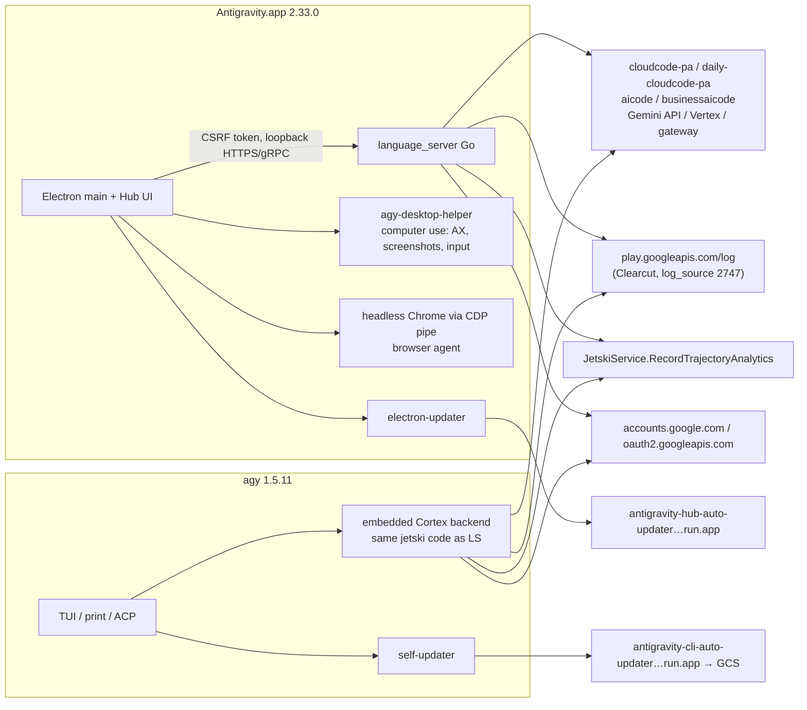
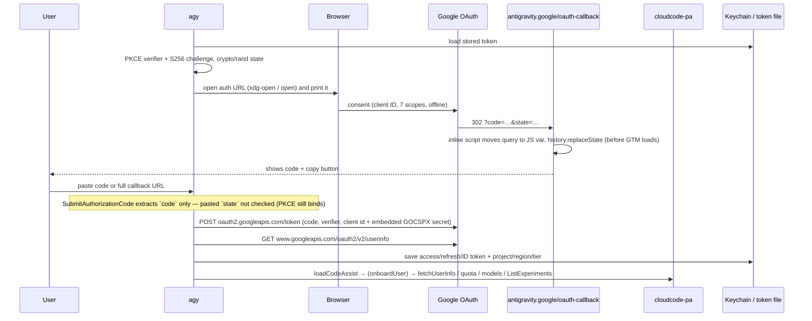
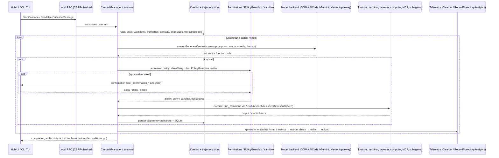

# Google Antigravity — Privacy Impact Assessment & Security Audit

Date: 2026-11-18 · Targets: Antigravity desktop 2.33.0 (macOS arm64) and Antigravity CLI `agy` 1.5.11

## 0. Artifacts

| Artifact | Version | Source | Integrity |
|---|---|---|---|
| Desktop app `Antigravity.dmg` (darwin-arm64) | 2.33.0 | `storage.googleapis.com/antigravity-public/antigravity-hub/2.33.0-4731201358004224/darwin-arm/Antigravity.dmg` | DMG SHA-256 `01267a5a4c4b615110c08eb14c61a3505ee8708e7a64f85d2880c867c31baf17`; app notarized, Developer ID Google LLC (EQHXZ8M8AV), hardened runtime, no App Sandbox |
| `language_server` (desktop agent backend, Go) | bundled | `Antigravity.app/Contents/Resources/bin/` | SHA-256 `59f20c05e424a13a04d0a93c342e06ec61155b87fa040a5a280bab240ba8348b` |
| CLI `agy` (darwin-arm64) | 1.5.11 | manifest `antigravity-cli-auto-updater-974169037036.us-central1.run.app/manifests/darwin_arm64.json` → GCS `cli_mac_arm64.tar.gz` | SHA-512 matches manifest; inner binary SHA-256 `62f21027…c677`, signed Google LLC (tarball unsigned) |
| Installer `install.sh` | — | `antigravity.google/cli/install.sh` | SHA-256 `62966c07365423bd4dc209355060744058fb30d60f5323e2d360e39de64e5042` |


## 1. Architecture



The desktop Electron layer is thin; the agent itself is the `language_server`. The CLI is **not** a client of that server — it embeds the same Cortex agent backend, model transports and telemetry client. Codeium/Windsurf lineage is visible throughout (`exa.*` protobuf packages, `x-codeium-csrf-token`, the trajectory key below).

## 2. Login flow

### 2.1 CLI interactive login (observed + static)

Authorization URL:

```
https://accounts.google.com/o/oauth2/auth
  ?client_id=1071006060591-tmhssin2h21lcre235vtolojh4g403ep.apps.googleusercontent.com
  &response_type=code &access_type=offline &prompt=consent
  &redirect_uri=https://antigravity.google/oauth-callback
  &code_challenge=<S256> &code_challenge_method=S256 &state=<random>
  &scope=cloud-platform userinfo.email userinfo.profile cclog experimentsandconfigs aicode openid
```



Variants (static):
- **ACP mode** (`agy acp`, IDE integration): separate loopback flow, `net.Listen("localhost:0")` → `http://localhost:<ephemeral>/auth/callback`, **state validated**, PKCE.
- **Business/GCP**: client `884354919052-36trc1jjb3tguiac32ov6cod268c5blh`, base scopes (no `aicode`/`openid`), Gemini Enterprise license / project checks.
- **Alternatives**: `GEMINI_API_KEY`, ADC/Vertex (`GOOGLE_CLOUD_PROJECT`/`LOCATION`), configured LLM gateway (can route prompts to non-Google providers), host-bridge auth, WIF.
- A device-code endpoint is compiled in but no CLI device-flow branch was found.

**Token storage (macOS).** Composite store: macOS Keychain via `zalando/go-keyring` (service `antigravity`), with **plaintext JSON fallback** at `~/.gemini/antigravity-cli/antigravity-oauth-token` (dir 0700, file 0600) when the keyring is bypassed, times out (marker `~/.gemini/antigravity-cli/cache/antigravity-keyring-unavailable`) or writes fail. The file may also hold project/region/tier metadata even when tokens are in Keychain. Plugin/MCP OAuth secrets use a separate file store (`~/.config/antigravity/plugin-secrets.json`; JSON, 0700/0600, unencrypted). `logout` deletes locally; no server-side revocation was found.

### 2.2 Desktop login

The Electron shell does not own the token: the LS prints `ANTIGRAVITY_OPEN_URL`/auth URLs on stdout, the shell opens them in the **system browser**, and the result returns via the `antigravity://` deep link to the renderer/LS. Same consumer client ID; business ID as above; Workforce Identity Federation (`a2a6f0e3e-…`). The LS has the same composite Keychain/file token storage (`jetski-standalone-oauth-token` label). For SSH-remote sign-in the shell pins auth origins, client IDs, exact scope sets, S256 PKCE and loopback callbacks (`remote/signInUrls.js`).

### 2.3 Scope assessment

`cloud-platform` grants the refresh token full Google Cloud API access as the user (all projects the account can reach, subject to IAM). It is needed for Cloud Code Assist/Vertex, but it makes the token at rest — and the plaintext fallback file — a high-value credential. `cclog` (Clearcut logging) and `experimentsandconfigs` exist to authenticate telemetry and experiment fetches.

## 3. Telemetry — what is sent

### 3.1 Observed: pre-login, pre-consent (CLI first launch)

One `POST https://play.googleapis.com/log` (Clearcut, **log_source 2747**, `Go-http-client/2.0`, protobuf) was sent within ~50 ms of the first `agy` launch, **before any sign-in, consent or settings screen**. Envelope (`JetskiTelemetryExtension`): `ide_name=antigravity`, `ide_version=1.5.11`, `os`, `arch`, `product_name=cli`, `is_redacted=true`. 14 events:

| Event | Notable payload |
|---|---|
| `hub_store_load_file_missing` ×2, `hub_store_load_succeeded`, `summaries_reconciled` | **persistent `installation_id`** (UUID in `~/.gemini/antigravity-cli/installation_id`), default `auto_execution_policy=…PROCEED_IN_SANDBOX` |
| `LS_BINARY_STARTUP`, `startup_completed` | ~25 per-phase startup timings |
| `summary_store_reconcile` ×2, `summary_store_json_vs_sqlite`, `conversation_search_index_warm` | local DB sizes, outcome |
| `env_overrides`, `model_config_overrides` | booleans: `gemini_api_key_set`, `gcp_project_set`, `gcp_location_set`, `model_provider`, … |
| `editor_mode_config` | vim/default editor mode |
| `terminal_env` | `shell`, `term`, `multiplexer`, `is_ssh`, `is_wsl`, `is_cloud_shell`, color depth, OSC8/OSC52 support, `cols_bucket`/`rows_bucket`, terminal emulator |

`machineId` was present but empty. No prompt text, paths, hostname or git remote appeared in this batch. This is fingerprinting-grade environment metadata keyed to a stable install ID, sent without consent. Static analysis confirms the cause: `NewStandaloneRecordAnalyticsEventFn` and `recordEventSafely` do not consult the telemetry setting.

### 3.2 Static: what the pipelines can carry after login

| Channel | Endpoint | Content (schema) | Gate |
|---|---|---|---|
| Clearcut `JetskiTelemetryExtension` | `play.googleapis.com/log` | envelope adds **`hashed_gaia_id`** (account-linkable), `host_identifier`, `user_tier_id`, `user_tags`, `region_code`, labs features, experiment config; payload variants include `CortexTrajectory`, **`CortexTrajectoryStep`**, `CortexGeneratorMetadata` (incl. **`prompt_debug_str`**), metrics, error traces, URL reads, hooks, remote-control events | `telemetry_enabled` + `payloadIsOptedOut` → `telemetryutil.Redact`; deferred decision **fails closed** ("redacting until it returns") |
| Trajectory analytics | `cloudcode-pa…/JetskiService/RecordTrajectoryAnalytics` | full trajectory segment as `google.protobuf.Struct` + metadata + Mendel experiment IDs | `SkipTelemetry` + `RedactOptedOutTrajectory` |
| Analytics RPCs | `RecordCommandUsage`, `RecordPrompt`, `RecordCompletions`, `RecordCortexTrajectoryStep`, `RecordCodeAssistMetrics`, `RecordClientEvent` | **`prompt`**, completion, prompt components, relative path, repository | same server-side settings |
| Business telemetry | `businessaicode…/TelemetryService/sendTelemetry` | inference/prompt/trajectory IDs, model, latency, tool-call counts, git-command categories | enterprise accounts |
| Desktop updater | `antigravity-hub-auto-updater…run.app/manifest/` | app version, arch, **stable `x-user-staging-id`** (`.updaterId`) | auto-check setting (default on, hourly) |
| CLI updater | `antigravity-cli-auto-updater…run.app` | version/platform (IP) | `AGY_CLI_DISABLE_AUTO_UPDATE=true` (exact string) |

Trajectory step schemas that ride these channels contain: user query + images; `CortexStepViewFile.content/raw_content` + absolute path; `CortexStepRunCommand.command_line, cwd, stdout, stderr, combined_output`; `CortexStepMcpTool.tool_call, result_string`; workspaces and artifacts. Request metadata (`exa.codeium_common_pb.Metadata`) has a **`device_fingerprint`** field, `session_id`, locale, hardware; `GitRepoInfo` carries repo name/owner/commit/remote URL. Population of every field after login is **not proven** — these are schemas with live recording call sites.

**Opt-out reality.**
- Setting: server-side `UserSettings.telemetry_enabled` (and `user_data_collection_force_disabled`), synced by `syncTelemetryFromServer`; on read failure it **defaults to disabled** (good).
- It governs **content** collection/redaction, not operational analytics: standalone/startup events (§3.1) bypass it. No `DO_NOT_TRACK` or universal env opt-out exists; ACP alone has `--disable-telemetry`.
- Business-auth accounts skip consumer telemetry propagation.
- None of this affects **model inference traffic**, which necessarily sends prompts, file excerpts, tool outputs, screenshots and MCP results to the selected backend. The desktop app hard-codes `--cloud_code_endpoint=https://daily-cloudcode-pa.googleapis.com` (`dist/lsDefaults.js:7`), Google's daily-named Cloud Code environment, rather than `cloudcode-pa`; the CLI's startup code also references the daily host (`main.init.func3`), but whether it is the CLI's effective default was not established. [INFERENCE] Data-handling terms for that environment may differ from production.
- Hub-spawned `chrome-devtools-mcp` has its own Clearcut telemetry **forcibly disabled** by the shell.

## 4. Full agent loop



**Context assembly:** the system prompt is up to 17 XML-tagged sections (identity, user_information incl. **hostname**/OS/workspace paths, mcp_servers, web_application_development, ephemeral_message, user_rules, workflows, skills, subagents, messaging, conversation_transcript, artifacts, slash_commands, terminal_sandbox, guidelines, communication_style) built from embedded Go templates plus code literals. Server flags (`template__system_prompts__<section>`) and section customizations can override it remotely. Each user turn is wrapped in `<USER_REQUEST>` + `<ADDITIONAL_METADATA>` (local time, user identity, active file, cursor line, open files). Full reconstruction: `work/prompts/SYSTEM_PROMPT.md`.

**Tools (compiled families):** `view_file`, `list_dir`, `grep_search`, `find`, `write_to_file`, `replace_file_content` (single/multi), sed-edit, `run_command` / `command_status` / `send_command_input`, `search_web`, read-URL, browser subagent (headless Chrome over a CDP pipe, separate profile), computer-use desktop tool, MCP call/list/read resources/MCP apps, notebooks, image generation, ask-permission / ask-question / send-message / finish, task/inbox/schedule (recurring background jobs), plan mode, native swarm (manage/post/read board/wait), invoke/define subagents, workflows, plugin marketplace search, git commit, plus Firebase/Cloud SQL/web-deploy tools.

**Policy:** command auto-exec policies `OFF | AUTO | EAGER | PROCEED_IN_SANDBOX` (CLI default observed: `PROCEED_IN_SANDBOX`); permission presets `REQUEST_REVIEW | DEFAULT | VETTED | TURBO | AUTO | NONE`; CLI `--mode accept-edits|auto|plan`, permission modes `strict|always-proceed|request-review|proceed-in-sandbox`, `--dangerously-skip-permissions`, `--sandbox`. Built-in sandbox allowlist: `head tail mkdir cd cp mv cat find grep rm touch less clear ls`. `BypassSandbox` requires manual approval. PolicyGuardian ships deterministic + model-review monitors for exfiltration, guardrail bypass, dangerous execution and persistence; URL denylist/antivirus RPCs check fetched URLs server-side (which also discloses those URLs to Google).

**Computer use (desktop, macOS 14+):** gated by a renderer-writable flag (`enable-agy-hub-cua-macos`, explicitly *not* a security boundary); requires Accessibility + Screen Recording TCC grants; actions restricted to per-conversation consented bundle IDs; screenshots, AX tree text, focused-window/URL metadata go to the LS and from there into model context. Kill switch: `/tmp/agy_desktop_endpoint_off`. Remote viewing (WebRTC with ECDSA-proven offers and first-pair local prompt) is compiled but **off** in the packaged build.

**Local persistence:** trajectories in `<app data>/conversations` (AES-GCM, see S-2) plus unencrypted SQLite trajectory store and `conversation_summaries.db`; `app_storage.json` (plaintext renderer state); `installation_id`, `jetski_state.pbtxt` (second `installation_uuid`), logs, crash files under `~/.gemini/antigravity-cli/` (CLI) or the Electron userData + `~/.gemini/antigravity` (desktop). The desktop keeps running in the background after windows close (macOS default).

## 5. Security findings (consolidated)

| ID | Sev | Component | Finding | Evidence |
|---|---|---|---|---|
| S-1 | **High** | Desktop shell | Local Hub enables `<webview>` without main-process `will-attach-webview` hardening of guest preferences/preload; a Hub renderer compromise (e.g., via rendered model/web content) could attach a privileged guest. [INFERENCE] exploit not demonstrated | Electron FINDINGS E-01 |
| S-2 | Medium | LS / CLI | Trajectory "encryption" uses a hard-coded shared AES-256-GCM key `safeCodeiumworldKeYsecretBalloon` (offset `0x3518488`); anyone with the files can decrypt prompts, code, command output | `setUpTrajectorySaver` `0x2c312e0` |
| S-3 | Medium | CLI updater + installer | Background self-update (every run, 15-min freshness, no prompt) trusts an unsigned manifest and its same-origin SHA-512; no publisher-signature / designated-requirement check before replacing the binary. Installer is `curl \| bash`, strips `com.apple.quarantine`, then runs `agy install`. Compromise of the Cloud Run release service = code execution on every install | CLI-01, CLI-05; `install.sh:226-239` |
| S-4 | Medium | Desktop updater | Setting `autoUpdater.channel` silently sets `allowDowngrade=true`; never reset → signed-but-older vulnerable builds accepted if the manifest offers them | `updater.js:163-171`, `AppUpdater.js:29-44` |
| S-5 | Medium | LS / CLI | Localhost TLS exception matches substring `https://localhost` in any of 8 endpoint env vars and sets `InsecureSkipVerify` on the shared Cloud Code transport (e.g., `https://localhost.attacker.tld`) | `localhostHTTPSOverride` `0x22193d0` |
| S-6 | Medium | Desktop shell | Runs the user's login shell interactively (`-ilc`, executes rc files) and passes the **entire** environment (API keys, cloud creds, `SSH_AUTH_SOCK`) to the LS and every tool/command it spawns | `loginShellEnv.js`, `languageServer.js:251` |
| S-7 | Medium | Desktop shell | Browser-agent guest sessions grant **all** web permission requests except 4 UI-lock types (camera/mic/geolocation/notifications subject only to TCC) | `guestPermissionPolicy.js:16-57` |
| S-8 | Medium | Desktop shell | Deep links (may carry OAuth codes) and full LS stdout incl. auth URLs are written to local logs; logs readable by renderer | `main.js:354`, `languageServer.js:310-344` |
| S-9 | Medium | Desktop shell | UI and Mendel-flag polling trust **any** certificate on `localhost`/`127.0.0.1` and send the admin CSRF token unpinned (the actuator transport is pinned correctly) | `languageServer.js:475-483`, `mendelFlagSync.js:111-131` |
| S-10 | Medium | Desktop shell | BeyondCorp PAC wrapper strips `xup.` proxies and falls back to `DIRECT` — silently bypasses mandatory corporate egress proxy | `beyondcorpPac.js:180-218` |
| S-11 | Medium | CLI / LS | OAuth refresh token (with `cloud-platform` scope) falls back to plaintext JSON `~/.gemini/antigravity-cli/antigravity-oauth-token`; plugin secrets always plaintext JSON | `NewCompositeTokenStorage`, `authstore.fileStore` |
| S-12 | Low | CLI | Pasted callback URL: `state` not validated (PKCE mitigates) | `SubmitAuthorizationCode` `0x101d7b0f0` |
| S-13 | Low | CLI | `agy install --dir` path interpolated unescaped into `export PATH="%s:$PATH"` in 6 shell profiles | `configureProfiles` `0x1032e9da0` |
| S-14 | Low | Installer | Predictable staging path `~/.cache/antigravity/staging/agy`, greedy `sed` JSON parsing, no host allowlist for payload URL | `install.sh:128-170` |
| S-15 | Low | Desktop shell | IPC handlers with inconsistent sender validation; renderer-selectable permissive external-protocol policy; hand-maintained public-suffix tables for credential stripping / WebAuthn RP-ID | E-08, E-09, E-10 |
| S-16 | Low | Desktop bundle | `NSAllowsArbitraryLoads=true`; Plugin helper has `disable-library-validation` + `allow-unsigned-executable-memory`; no App Sandbox | Info.plist, entitlements |
| S-17 | Info | All | Embedded native-app OAuth secrets (`GOCSPX-…`, 3 clients) — public by design for installed apps, not a leak | CLI §2 |
| S-18 | **High** | LS / CLI | Repo `AGENTS.md`/`GEMINI.md`/`.agents/rules` load with **no workspace-trust check** (the trust gate covers skills/workflows/plugins/MCP/hooks only), and `@[label](path)` includes are expanded with no containment check (`~/`, absolute, `../` allowed). A malicious repo can make the agent inline e.g. `~/.aws/credentials` into the system prompt sent to the model on every turn, with no tool call or approval. [INFERENCE: static, not executed] | `customizations.resolveFileIncludes`, `getRules`; `work/prompts/SYSTEM_PROMPT.md` §7 |

Positive controls verified statically: S256 PKCE everywhere; CSRF + scoped tokens on the local LS RPC; LS bound to localhost (remote-accessible flag exists); pinned cert on the actuator channel; constant-time bearer check on the host bridge; browser script jail (no network, no permissions, worker isolation); `agy-desktop-script` runs with empty env, RSS/time limits and self-tested Seatbelt; computer-use per-app consent + takeover fencing; network-capture sanitizer strips tokens/cookies and suppresses IdP traffic; Seatbelt (`/usr/bin/sandbox-exec`) for sandboxed terminal commands; telemetry redaction fails closed; DMG/app notarized.

No Critical issue, sandbox escape, or unauthenticated RCE was established.

## 6. Privacy impact assessment

### 6.1 Data inventory

| Data | Collected from | Goes to | When | User control |
|---|---|---|---|---|
| Installation UUID, OS/arch, version, terminal/shell/multiplexer, config booleans, timings | runtime | Clearcut | **every launch, before login** | none observed |
| Updater staging UUID, version, IP | `.updaterId` | Hub updater (Cloud Run) | startup + hourly | disable auto-update |
| Google email, name, picture, account tier, GAIA (hashed in telemetry) | OAuth userinfo, `loadCodeAssist` | Google; local token store | login, refresh | required for Google auth |
| OAuth refresh token (`cloud-platform`) | login | Keychain or plaintext file | login | logout (local only) |
| Prompts, chat history, attached images | user | model backend | every turn | none (core function) |
| Source files, diffs, paths, git repo info | workspace via tools/context | model backend; trajectory telemetry (schema) | tool use / context | `.gitignore` access setting; telemetry setting for analytics |
| Shell commands, cwd, stdout/stderr | terminal tool | model backend; trajectory telemetry (schema) | agent runs command | approval policy; telemetry setting |
| Environment variables / secrets | login shell env | all spawned tools; into model context if a tool prints them | startup | none |
| Screenshots, AX trees, window/app names, browser URLs | computer use / browser agent | LS → model backend | when tool used | TCC grants, per-app consent |
| Visited URLs | browser / read-URL | Google URL denylist/antivirus RPC; model | per URL | none observed |
| MCP tool args/results, MCP credentials | MCP servers | third-party servers; model; telemetry schema | MCP use | per-server config |
| Microphone audio | voice / dictation / `mic-serve` | model/transcription | voice use | mic TCC |
| Conversation trajectories, summaries, artifacts | agent | local disk (weakly encrypted / plaintext) | continuous | manual deletion |

### 6.2 Risk assessment

| Risk | Likelihood | Impact | Rating |
|---|---|---|---|
| Source code, secrets and command output processed by Google model backends (default endpoint named `daily-cloudcode-pa`) | Certain | High for confidential repos | **High** |
| Content-bearing trajectory telemetry linked to `hashed_gaia_id` + installation ID if telemetry enabled | Likely for consumer tier unless opted out | High | **High** |
| Pre-consent environment telemetry with persistent installation ID | Certain (observed) | Low–Medium (device profiling) | **Medium** |
| Full `cloud-platform` token on disk (plaintext fallback) | Possible | High (GCP account takeover by local malware) | **Medium–High** |
| Exported secrets in shell env reaching agent tools and model | Likely | High | **High** |
| Local trajectories readable via public hard-coded key | Possible (backup/theft/malware) | Medium | **Medium** |
| Prompt injection from web/MCP/repo content steering tools (exfiltration) | Possible; mitigated by approvals, PolicyGuardian, sandbox | High | **Medium** (High with `--dangerously-skip-permissions` / TURBO) |
| Supply-chain update compromise (CLI) | Rare | Critical | **Medium** |

### 6.3 Recommendations for users / deployers

1. Treat both products as remote agents with shell, filesystem, browser and (desktop) screen authority. Use them only on repositories you are permitted to send to Google; use enterprise/Vertex routing with contractual data terms for confidential code.
2. Turn off telemetry / user-data collection in account settings; accept that operational events and pre-login events still flow. Block `play.googleapis.com/log` at the network layer if zero analytics is required (the CLI tolerates failures).
3. Launch from a minimal environment: do not export long-lived secrets in shell rc files; the desktop app inherits them all.
4. Keep the default sandboxed terminal policy; avoid `--dangerously-skip-permissions`, TURBO/EAGER modes, and auto-approved MCP on untrusted inputs.
5. Ensure the Keychain path works and check that `~/.gemini/antigravity-cli/antigravity-oauth-token` doesn't exist with tokens; exclude `~/.gemini` from cloud backups; consider a dedicated Google account without broad GCP IAM.
6. Managed fleets: install a pinned, verified build, set `AGY_CLI_DISABLE_AUTO_UPDATE=true`, disable desktop auto-update channel changes, and don't use `curl | bash`.

### 6.4 Recommendations for the vendor

Gate *all* telemetry (incl. startup/standalone events) on consent; replace the shared trajectory key with a Keychain-held per-user key; sign update manifests and verify code signatures before swapping binaries; reset `allowDowngrade`; parse-and-exact-match loopback for the TLS exception; minimal env contract for the LS; default-deny guest web permissions; redact auth parameters from logs; validate pasted `state`; shell-quote install paths; request a narrower scope than `cloud-platform` where possible; document why consumer traffic defaults to `daily-cloudcode-pa`.
