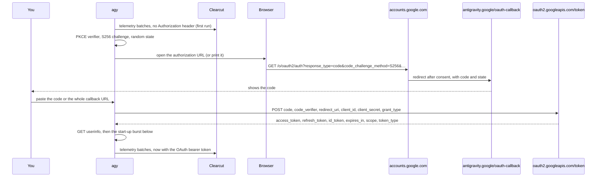
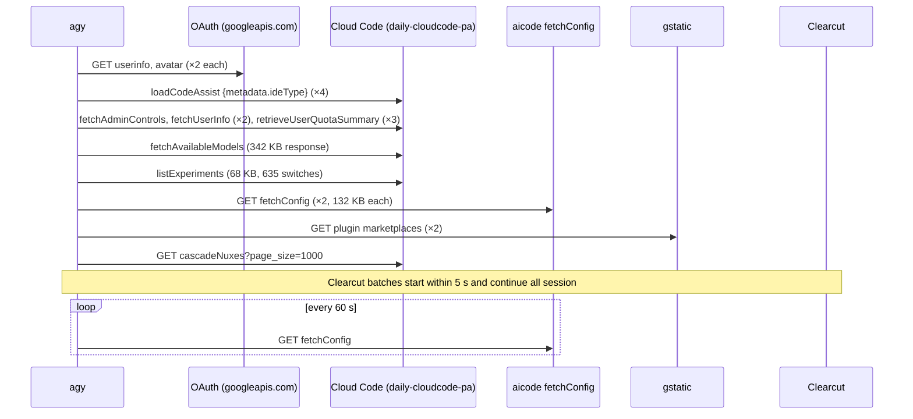
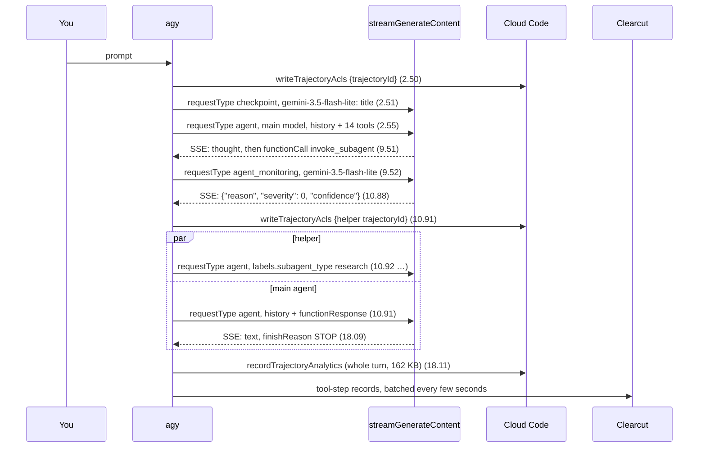

# Protocols and request flows

How `agy` 1.5.14 talks to Google and to apps that drive it: which transport each request uses, in what order requests go out, and how each request and response is laid out. What the content means is covered in the analysis: prompt and history content in [prompts-and-context.md](../../../analysis/cli/prompts-and-context.md), the review models in [safety-reviews.md](../../../analysis/cli/safety-reviews.md), telemetry content in [data-collection.md](../../../analysis/cli/data-collection.md), helpers and swarms in [agents-and-swarm.md](../../../analysis/cli/agents-and-swarm.md), sign-in and plan gating in [sign-in-and-plans.md](../../../analysis/cli/sign-in-and-plans.md), and the server switches in [server-switches.md](../../../analysis/cli/server-switches.md).

Evidence is `agy` 1.5.14 traffic unless a line says otherwise. Field layouts with every placeholder are in the `wire-*.md` files next to this one, linked from each section.

## Transports

| Destination | Method | Body | Auth | HTTP | When |
|---|---|---|---|---|---|
| `daily-cloudcode-pa.googleapis.com/v1internal:streamGenerateContent?alt=sse` | POST | JSON in, server-sent events out | OAuth bearer | 1.1 | Every model call: the agent, its helpers, the review models, the command adjudicator, title generation, compaction |
| `daily-cloudcode-pa.googleapis.com/v1internal:<method>` (9 methods) | POST, one GET | JSON | OAuth bearer | 1.1 | Account bootstrap, quota, models, switches, trajectory registration and upload |
| `aicode.googleapis.com/v1alpha:fetchConfig` | GET | none in, 132 KB JSON out | OAuth bearer | 1.1 | At start, then every 60 seconds |
| `play.googleapis.com/log` | POST | protobuf `LogRequest` | none before sign-in, then OAuth bearer | 2 | Telemetry batches, from the first seconds of the first run |
| `oauth2.googleapis.com/token` | POST | form | client ID and secret in the form | 1.1 | Sign-in code exchange, token refresh |
| `www.googleapis.com/oauth2/v2/userinfo`, `lh3.googleusercontent.com` | GET | none | OAuth bearer | 1.1 | Account name, email and avatar |
| `www.gstatic.com/antigravity/plugins{,-partners}/marketplace.json` | GET | none | none | 2 | Plugin catalogues, with `If-Modified-Since` |
| stdin/stdout of `agy acp` | JSON-RPC 2.0 | newline-delimited JSON | ACP `authenticate` | — | An app driving `agy` |

All Google API requests carry the same user agent:

```text
antigravity/cli/1.5.14 (aidev_client; os_type=[os]; arch=[arch]; cl=1026970498; auth_method=consumer)
```

The plugin catalogues send it without `auth_method`. Clearcut, the token endpoint, `userinfo` and the avatar go out with Go's default `Go-http-client` user agent.

The Cloud Code methods map onto the gRPC services `google.internal.cloud.code.v1internal.PredictionService` (`StreamGenerateContent`, `FetchAvailableModels`, `RetrieveUserQuotaSummary`), `CloudCode` (`LoadCodeAssist`, `ListExperiments`, `FetchAdminControls`) and `JetskiService` (`FetchUserInfo`, `ListCascadeNuxes`, `WriteTrajectoryACLs`, `RecordTrajectoryAnalytics`), sent as their JSON mapping over plain HTTPS. The client side is `jetski/language_server/code_assist_client/codeassistclient.(*CodeAssistClient)`, which the desktop app's language server shares; its methods `openStreamGenerateContent`, `FetchLoadCodeAssistResponse`, `ListExperiments`, `FetchAvailableModels`, `RetrieveUserQuotaSummary`, `FetchAdminControls`, `FetchUserInfo`, `ListCascadeNuxes`, `WriteTrajectoryACLs` and `RecordTrajectorySegmentAnalytics` each issue one of these requests.

## Sign-in

Interactive `agy` signs in with OAuth 2.0 and PKCE through a hosted callback page, so nothing listens on your machine. You paste the code back:



The authorization request carries:

| Parameter | Value |
|---|---|
| `response_type` | `code` |
| `client_id` | The CLI's installed-app client ID |
| `redirect_uri` | `https://antigravity.google/oauth-callback` |
| `scope` | `cloud-platform`, `userinfo.email`, `userinfo.profile`, `cclog`, `experimentsandconfigs` and `aicode` under `https://www.googleapis.com/auth/`, plus `openid` |
| `state` | 22 random characters |
| `code_challenge`, `code_challenge_method` | 43-character S256 challenge, `S256` |
| `access_type`, `prompt` | `offline`, `consent` |

The client builds the URL in `jetski/cli/backend/auth/auth.(*oauthMethod).StartInteractive` (with `generateState`, `oauth2.GenerateVerifier`, `oauth2.S256ChallengeFromVerifier` and `Config.AuthCodeURL`). `(*oauthMethod).SubmitAuthorizationCode` accepts a bare code or a URL, reads the URL's query and hands over to `completeOAuth`, which makes the token exchange. Later starts refresh the token at the same endpoint with `refresh_token`, `client_id`, `client_secret` and `grant_type`; a refresh token that is no longer valid gets `400` with `error` and `error_description`. What the scopes and the account tier decide is in [sign-in-and-plans.md](../../../analysis/cli/sign-in-and-plans.md); layouts are in [wire-account-and-config.md](wire-account-and-config.md#sign-in).

`agy acp` signs in differently, with a local callback. In the 1.5.14 binary, `jetski/cli/acp/auth/auth.(*loopbackLogin).acquire` listens on a random local TCP port, builds the redirect `http://localhost:<port><path>`, draws a random state with `crypto/rand.Text`, makes a PKCE verifier and S256 challenge, and opens the authorization URL. Its callback handler (`callbackHandler`) answers `400 Invalid or missing state parameter.` when the state doesn't match, and `400 Missing authorization code.` when there is no code; otherwise the client exchanges the code with the verifier and shuts the listener down.

## Start of a session

On every start, the client fires a bootstrap burst. In one session, the first 2.5 seconds held 21 requests, several of them repeats:



Which of these responses decides what (plan, models, switches) is in [sign-in-and-plans.md](../../../analysis/cli/sign-in-and-plans.md) and [server-switches.md](../../../analysis/cli/server-switches.md). Layouts: [wire-account-and-config.md](wire-account-and-config.md).

## One turn

A prompt that delegates to the research helper, as it went out on the wire (times are seconds from the start of the session):



The pattern for every tool call:

1. The model streams back one or more `functionCall` parts. Parallel calls arrive together in one response.
2. Before a call runs, the client may send it to a review model as a separate `agent_monitoring` request and waits for the answer; here the wait was 1.4 seconds. Commands that ask to leave the sandbox in auto mode go to the adjudicator, a separate `agent` request on `gemini-4-hydrogen-medium` with its own six tools. When each review runs and what it does with the answer is in [safety-reviews.md](../../../analysis/cli/safety-reviews.md).
3. The tool runs. A sandboxed command runs in a fresh copy of `agy` that the client starts for it ([sandbox-and-permissions.md](../../../analysis/cli/sandbox-and-permissions.md)).
4. The result goes back in the next `streamGenerateContent` request, which resends the whole history.
5. The step is logged to Clearcut as a `cortex_trajectory_step` record in the next batch.

When the turn ends, the client uploads the turn with `recordTrajectoryAnalytics`. A helper is its own trajectory: it registers its own `trajectoryId`, makes its own model calls with `labels.subagent_type` and `labels.parent_cascade_id`, and keeps running after the main agent's turn ends. Its report reaches the main agent as a user-role text part wrapped in `<SYSTEM_MESSAGE>`, in whatever request the main agent makes next ([injections.md](../traffic/injections.md)). The timeline of a full two-prompt session is in [One session, traced](../session-1/README.md).

## The model call

Every model call, whoever makes it, is a `POST …/v1internal:streamGenerateContent?alt=sse` with this envelope:

| Field | Value |
|---|---|
| `project` | The account's Cloud AI Companion project, from `loadCodeAssist` |
| `requestId` | `agent/<cascadeId>/<epoch ms>/<trajectoryId>/<n>` for agent calls and compaction (with a `checkpoint/` prefix); `agent_monitoring/<uuid>` for reviews and `checkpoint/<uuid>` for titles |
| `model` | Model ID with the thinking level as suffix (`gemini-4-neon-medium`) |
| `userAgent` | `antigravity` |
| `requestType` | `agent`, `agent_monitoring` or `checkpoint` |
| `request` | A Vertex AI `GenerateContentRequest` |

This is the JSON mapping of `v1internal.GenerateContentRequest` (in the desktop protos as [`google__internal__cloud__code__v1internal__prediction_service.proto`](../../desktop/protos/google__internal__cloud__code__v1internal__prediction_service.proto)); `agy` never sends its `user_prompt_id` or `enabled_credit_types` fields.

The inner `request` differs by caller:

| Caller | `requestType` | Model | `systemInstruction` | `tools` | `labels` | `generationConfig` |
|---|---|---|---|---|---|---|
| Main agent | `agent` | Your model | 16–19 KB, depending on mode | 14 declarations | 9 keys | `maxOutputTokens`, `thinkingLevel` |
| Research helper | `agent` | Your model | about 6.5 KB | 6 | adds `parent_cascade_id`, `subagent_type: research` | same |
| `/boost` roles | `agent` | Your model | 7–8.5 KB | 10–12 | `subagent_type` names the role (`DeepCoder`, `DeepCoderWorkerL0`, `DeepCoderImprovementWorker`) | same |
| Command adjudicator | `agent` | `gemini-4-hydrogen-medium` | about 11 KB | 6, ending in `submit_verdict` | no `root_cascade_id` | `thinkingLevel: MEDIUM` only |
| Step review | `agent_monitoring` | `gemini-3.5-flash-lite` | none | none | none | `thinkingLevel: MINIMAL` |
| History review | `agent_monitoring` | `gemini-4-hydrogen-sonar` | none | none | none | `thinkingLevel: LOW` |
| Title generator | `checkpoint` | `gemini-3.5-flash-lite` | 626 bytes | none | none | `thinkingLevel: LOW` |
| Compaction | `checkpoint` | Your model | the main agent's | the main agent's | the main agent's | `maxOutputTokens: 32768` |

Agent and checkpoint calls also carry `sessionId`, a signed 64-bit integer as a decimal string; the review calls send none. No request sets `toolConfig`, `safetySettings`, `cachedContent`, temperature or any sampling parameter. Caching happens on the server anyway: responses report `cachedContentTokenCount` on long histories.

The review calls put their whole input, rubric and transcript and pending call, into a single user text part (10–12 KB for a step review, 23 KB for one history review), and get the verdict back as text: a fenced JSON block with `reason`, `severity` and `confidence`. The adjudicator gets a real system prompt and tools, and answers with a `submit_verdict {reversible, reason}` function call.

### History layout

`contents` is the full conversation, resent on every call:

| Entry | `role` | Parts |
|---|---|---|
| A prompt you typed | `user` | One text part: `<USER_REQUEST>`, `<ADDITIONAL_METADATA>` and, when a setting changed, `<USER_SETTINGS_CHANGE>` |
| The model's step | `model` | Optional `thought: true` text, optional answer text, and `functionCall {name, args, id}` parts |
| Tool results | `model` | One `functionResponse {name, id, response}` per call, with `response.output` or `response.error` |
| A helper's report, a swarm post, a timer tick | `user` | One text part wrapped in `<SYSTEM_MESSAGE>` |

Tool results go back under `role: model`, not `user` as the Gemini API documents; all 1,062 `functionResponse` parts in the captured sessions did. `thoughtSignature` rides on the first `functionCall` of a parallel batch only, and on some text parts. `systemInstruction` itself is sent with `role: user`. What goes inside the text parts is in [prompts-and-context.md](../../../analysis/cli/prompts-and-context.md).

### Response stream

The response is `text/event-stream`, one `data: {json}` line per event, separated by `\r\n\r\n`, with no `event:` lines. Each event is a whole `v1internal.GenerateContentResponse`:

- `response.candidates[0].content` with `role: model` and the parts produced since the last event: thought text, answer text or `functionCall`s;
- `response.usageMetadata` (`promptTokenCount`, `candidatesTokenCount`, `thoughtsTokenCount`, `totalTokenCount`, and `cachedContentTokenCount` when the cache hit), repeated in every event;
- `response.modelVersion` (the model without the thinking suffix, such as `gemini-4-neon`, or a variant such as `gemini-4-argon-trial`) and `response.responseId`;
- `traceId` and an empty `metadata` object.

The last event carries `finishReason: STOP` and an empty text part; all 223 completed streams captured ended this way, whether the model answered or called tools. A failed call comes back as a non-streamed `google.rpc.Status` JSON body with an `ErrorInfo` detail, such as `503 UNAVAILABLE` with reason `MODEL_CAPACITY_EXHAUSTED`; whether the client retries is set per model by the `retry_model_capacity_exhausted` switch in `fetchAvailableModels`.

Layouts with every field: [wire-model-request.md](wire-model-request.md) for the agent call and its stream, [wire-side-model-requests.md](wire-side-model-requests.md) for the reviews, the adjudicator, titles and compaction, and [monitor-request.md](../traffic/monitor-request.md) for a full escalated review.

### IDs that link the calls

| ID | Where it appears | Scope |
|---|---|---|
| `cascade_id` | `labels`, `requestId`, trajectory uploads | One conversation, or one helper conversation |
| `root_cascade_id`, `parent_cascade_id` | `labels` | The top conversation, and the conversation that started a helper |
| `trajectory_id` | `labels`, `requestId`, `writeTrajectoryAcls`, trajectory uploads, Clearcut | One run of a conversation |
| `request_id` label | `labels` | `<trajectory_id>-<n>`, counting model calls in the trajectory |
| `last_step_index` | `labels` | The trajectory step the call follows |
| `sessionId` | `request` | One conversation: the main agent shares it with its title and adjudicator calls; each helper has its own |

## Trajectory registration and upload

`writeTrajectoryAcls` sends `{"trajectoryId": "<uuid>"}` when a trajectory starts, once for the main conversation and once per helper, and gets back `{}`. `recordTrajectoryAnalytics` sends `trajectory`, `metadata` and `mendelExperimentIds`, plus `startStepIndex` and `startGeneratorMetadataIndex` when it continues an earlier upload, and gets back `{}`. Uploads in one session ran from 159 KB to 406 KB each. `trajectory` holds `cascadeId`, `trajectoryId`, `trajectoryType`, `source`, `executorMetadatas` (the agent's whole configuration), `steps` and `generatorMetadata` (each with the full `chatModel` request); `metadata` holds `ideName`, `ideVersion`, `os`, `hardware`, `productName`, `regionCode` and `userTierId`. What the steps and generator records contain is in [data-collection.md](../../../analysis/cli/data-collection.md); layout: [wire-trajectory.md](wire-trajectory.md).

## Clearcut

`play.googleapis.com/log` takes a binary protobuf `wireless_android_play_playlog.LogRequest`:

| Field | Number | Content |
|---|---|---|
| `client_info` | 1 | `client_type` 16; on the error-trace source, also a desktop client info with OS, version and the application identifier `antigravity_desktop` |
| `log_source` | 2 | 2747, 327 or 2992 |
| `log_event` | 3, repeated | `event_time_ms` (1), `source_extension` (6, the record), `event_code` (11) |
| `request_time_ms` | 4 | Send time |

The three log sources carry different records:

| `log_source` | `source_extension` is | Share of batches in four sessions |
|---|---|---|
| 2747 | `devtools.jetski.telemetry.JetskiTelemetryExtension`: product fields (16 `ide_name`, 17 `ide_version`, 18 `os`, 19 `arch`, 22 `user_tier_id`, 25 `region_code`, 27 `product_name`) plus one payload, most often a hook execution (38), a monitor signal (30), a trajectory step (12) or an analytics event (6) | 137 of 162 |
| 327 | Error traces (`LS_ERROR` with message and stack) tagged `antigravity-cli` | 11 |
| 2992 | The Clearcut library's own report on its uploads for source 2747: window, records logged, bytes and HTTP status per upload | 14 |

The field numbers of `JetskiTelemetryExtension` in the `agy` 1.5.14 binary match the desktop app's [`devtools__jetski__telemetry__telemetry.proto`](../../desktop/protos/devtools__jetski__telemetry__telemetry.proto), so the dotted paths in other excerpts (`3.6.12…` for a tool step) read as `log_event.source_extension.cortex_trajectory_step…`. The response is a protobuf `LogResponse` whose `next_request_wait_millis` was 5,000 in every batch. Layout: [wire-clearcut.md](wire-clearcut.md); content: [data-collection.md](../../../analysis/cli/data-collection.md).

## ACP

`agy acp` speaks JSON-RPC 2.0 over stdin and stdout, one JSON object per line. In 1.5.14 a front process routes each session to a worker process (`--process-per-session`; the worker runs with `--worker`), implemented by `jetski/cli/acp/router/router.(*Router)` with `relayToNewWorker`, `callWorker` and `routeClientResponse`.

The server has one handler per client method in `jetski/cli/acp/server/server.(*Server)`: `handleInitialize`, `handleAuthenticate`, `handleLogout`, `handleSessionNew`, `handleSessionLoad`, `handleSessionList`, `handleSessionClose`, `handleSessionPrompt`, `handleSessionCancel`, `handleSessionSetMode`, `handleSessionSetModel` and `handleSessionSetConfigOption`. It sends `session/update` notifications of ten kinds, one message type each in `jetski/cli/acp/messages/messages`: `user_message_chunk`, `agent_message_chunk`, `agent_thought_chunk`, `tool_call`, `tool_call_update`, `available_commands_update`, `current_mode_update`, `config_option_update`, `session_info_update` and `usage_update`. Tool-call content comes in two kinds only, text content and a diff (`ContentToolCallContent`, `DiffToolCallContent`). There is no `subagent_update` message type and no string for it in the binary.

```mermaid
sequenceDiagram
  participant App as ACP client
  participant F as agy acp (front)
  participant W as session worker
  participant G as Google
  App->>F: initialize
  F-->>App: capabilities, authMethods, _meta
  App->>F: authenticate
  App->>F: session/new
  F->>W: start worker, relay
  App->>F: session/prompt
  F->>W: relay
  W->>G: streamGenerateContent … (as in "One turn")
  W-->>App: session/update agent_thought_chunk / agent_message_chunk
  W-->>App: session/update tool_call, tool_call_update
  opt the main agent's tool needs approval
    W->>App: session/request_permission
    App-->>W: outcome
  end
  W-->>App: session/prompt result
  Note over W,App: steps the main agent takes after the turn (on a helper's report or a timer) arrive as session/update outside any prompt request (sendOutOfTurnStepUpdates); the helper's own steps do not
```

The `initialize` response advertises `loadSession`, image and embedded-context prompts, session `resume`/`close`/`load`/`list`/`additionalDirectories`, `auth.logout`, and four auth methods: `oauth-personal`, `oauth-business`, `gemini-api-key` and `agent-platform`. Several capabilities are sent twice, in camelCase and snake_case (`loadSession` and `load_session`, `sessionCapabilities` and `session_capabilities`). Unauthenticated `session/new` gets `{"code": -32000, "message": "Authentication required"}`. Those two responses were captured from 1.5.11; the 1.5.14 binary contains the same server name, auth method IDs and capability keys. Layout: [wire-acp.md](wire-acp.md). What ACP leaves out for integrators is in [agents-and-swarm.md](../../../analysis/cli/agents-and-swarm.md).
