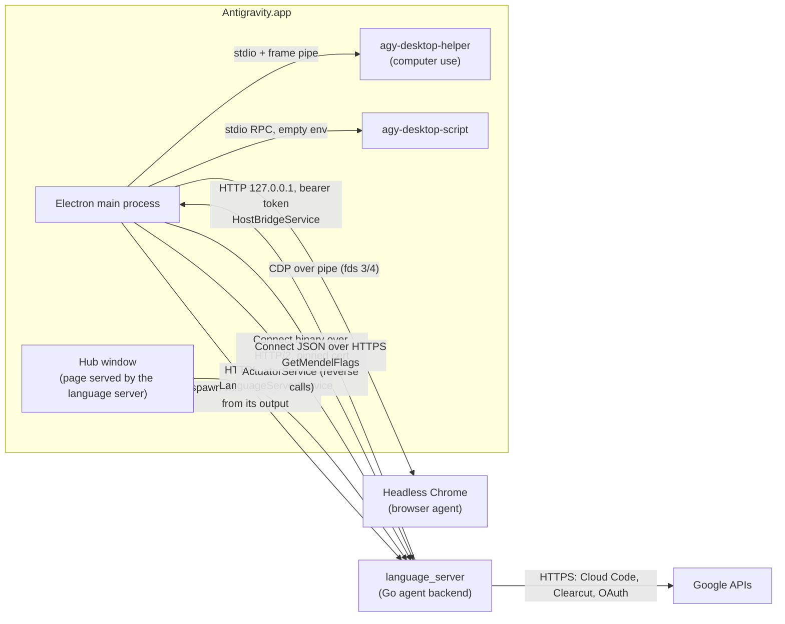
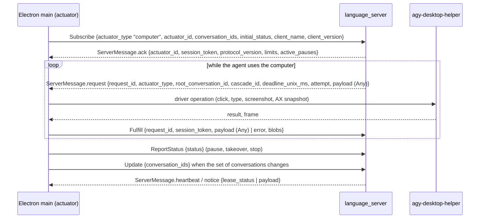
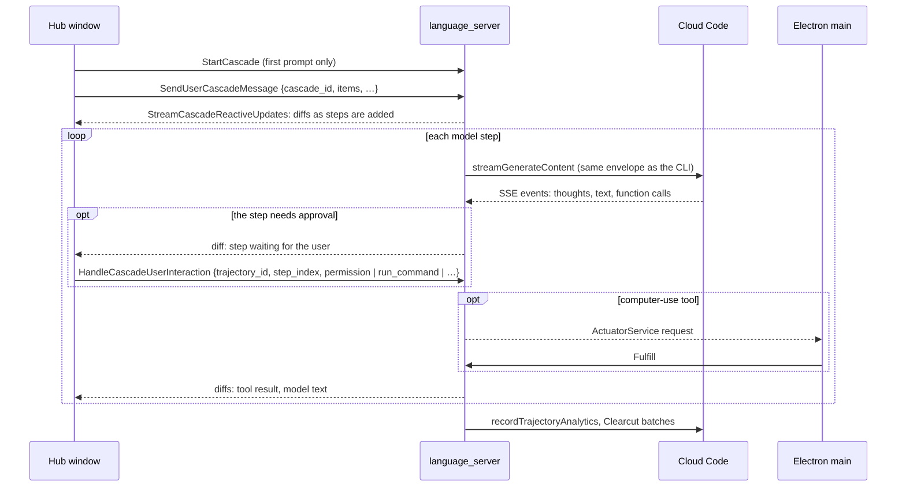

# Desktop app: protocols and request flows

How the parts of the Antigravity 2.33.0 desktop app for macOS talk to each other and to Google, and how their messages are laid out. This is static analysis of the app bundle and of the protobuf descriptors in its agent backend, `language_server`. Paths are relative to `app.asar/dist/`. Message definitions are in [the desktop protos](../protos/INDEX.md); the security review of the same channels is in [electron-shell.md](../../../analysis/desktop/electron-shell.md) and [language-server.md](../../../analysis/desktop/language-server.md). The CLI's wire traffic, which the backend shares, is in [the CLI's protocols and request flows](../../cli/protocol/protocol-and-requests.md).

## Parts and channels

| Channel | Transport | Auth | Evidence |
|---|---|---|---|
| Electron main → language server, start | Process spawn with `--standalone`, `--https_server_port`, `--csrf_token`, `--app_data_dir`, `--api_server_url=https://generativelanguage.googleapis.com`, `--cloud_code_endpoint=https://daily-cloudcode-pa.googleapis.com`, `--enable_sidecars` and host-bridge URL and token; the port is parsed from the server's output, waiting up to 60 seconds | — | `lsDefaults.js`, `languageServer.js` ([electron-shell.md §3](../../../analysis/desktop/electron-shell.md#3-language-server-launch-environment-ports-tokens-tls)) |
| Hub window → language server | The window loads `https://127.0.0.1:<port>/` from the language server itself and is reloaded at the new port when the server restarts | The server's interceptor checks `x-codeium-csrf-token` on local RPCs ([language-server.md §5](../../../analysis/desktop/language-server.md#5-agent-loop-reconstruction)) | `constants.js` (`WINDOW_ORIGIN`), `main.js` (`onPortChanged`) |
| Electron main → `GetMendelFlags` | `POST /exa.language_server_pb.LanguageServerService/GetMendelFlags`, Connect protocol with JSON (`connect-protocol-version: 1`, body `{}`) | CSRF token header; certificate not verified | `mendelFlagSync.js` |
| Electron main → `ActuatorService` | Connect protocol, binary protobuf, HTTP/2 with a 15-second ping; TLS pinned to the language server's bundled certificate | CSRF token header | `actuator/nodeTransport.js` |
| Language server → Electron main | `HostBridgeService` over HTTP on an ephemeral `127.0.0.1` port: `GetUpdateStatus`, `ApplyUpdate`, `GetOAuthToken` | 32-byte random bearer token, peer and Host checks | `hostBridgeServer.js` |
| Electron main → computer-use helper | `agy-desktop-helper serve` with piped stdin/stdout and a separate frame and media pipe | — | `computer/desktopHelper.js` |
| Electron main → native script runner | `agy-desktop-script` child with an empty environment and a supervised stdio RPC | — | `computerActuator/scriptRunner.js` |
| Electron main → browser | Chrome with `--headless=new --remote-debugging-pipe`, CDP on file descriptors 3 and 4, no TCP debugging port | — | `browserEngine/browserEngine.js`, `browserEngine/cdpPipe.js` |
| SSH remote | A language server on the remote host, called with Connect JSON over HTTP on the remote loopback (`GetSidecars`, `Exit`, other methods) through the SSH transport | — | `remote/sshConnection.js`, `remote/remoteSidecars.js` |

## The language server's local API

`exa.language_server_pb.LanguageServerService` has 377 methods. The ones that carry a conversation:

| Method | Shape | Role |
|---|---|---|
| `StartCascade` | unary | Create a conversation: workspace URIs, requested model, custom agent, subagent descriptor, parent conversation; returns `cascade_id` |
| `SendUserCascadeMessage` | unary, empty response | Send a prompt: text and scope items, images and media, file, diff and artifact comments, cascade config, delivery strategy |
| `HandleCascadeUserInteraction` | unary | Answer a pending step: `trajectory_id`, `step_index` and one interaction |
| `CancelCascadeInvocation`, `CancelCascadeSteps`, `ForceStopCascadeTree` | unary | Stop a turn, some steps, or a whole conversation tree |
| `StreamCascadeReactiveUpdates`, `StreamCascadePanelReactiveUpdates`, `StreamCascadeSummariesReactiveUpdates`, `StreamUserTrajectoryReactiveUpdates` | server stream | Push conversation state to the UI as versioned diffs |
| `StreamAgentStateUpdates` | server stream | Push agent state pages |
| `GetCascadeTrajectory`, `GetCascadeTrajectorySteps`, `GetCascadeTrajectoryGeneratorMetadata` | unary | Read a stored conversation, its steps and the model requests behind them |
| `GetMendelFlags`, `SetMendelFlagOverrides` | unary | Read the server switches, and override them locally |
| `GetPermissionSettings`, `UpdatePermissionSettings` | unary | Read and change permission settings |

The reactive streams send changes, not whole objects. A subscriber sends `{protocol_version, id, subscriber_id}` and gets back `{version, diff}` messages, where `diff` is a list of `FieldDiff {field_number, update_singular | update_repeated | update_map | clear}` applied to the conversation's protobuf by field number.

A pending approval is answered with `HandleCascadeUserInteraction`, whose `CascadeUserInteraction` carries `trajectory_id`, `step_index`, `timed_out` and exactly one of 18 interaction kinds, among them `permission`, `file_permission`, `run_command`, `send_command_input`, `read_url_content`, `mcp`, `browser_action`, `execute_browser_javascript`, `ask_question`, `elicitation` and `approval_interaction`.

The server also defines `ChatClientServerService.StartChatClientRequestStream`, a server stream through which it sends requests to a chat client, and `ExtensionServerService` (53 methods, such as `OpenFilePointer`, `ExecuteCommand`, `ReadTerminal`, `GetSecretValue`, `StoreSecretValue`) for calling back into an editor host.

## Computer use: calls that run in reverse

The language server can't call the Electron main process, so `ActuatorService` turns a server stream into a request channel:

The `computer_viewer` actuator uses the same channel to relay remote-viewing offers ([electron-shell.md §5](../../../analysis/desktop/electron-shell.md#5-desktophost-remote-viewer-pairing-webrtc)). Screenshots, accessibility snapshots and window metadata go back to the language server in `Fulfill` payloads and blobs.

## One turn

Reconstructed from the services above and the backend's agent loop ([language-server.md §5](../../../analysis/desktop/language-server.md#5-agent-loop-reconstruction)):

## Requests to Google

The language server ships the same Cloud Code client as the CLI (`jetski/language_server/code_assist_client/codeassistclient`), and the launch flags point it at the same `daily-cloudcode-pa.googleapis.com` endpoint, so its model, account and trajectory calls use the layouts in [the CLI's protocols and request flows](../../cli/protocol/protocol-and-requests.md). The descriptors show the fields of those calls that the CLI didn't send:

| Message | Field | Content |
|---|---|---|
| `v1internal.GenerateContentRequest` | `user_prompt_id` (5) | An ID for the user's prompt |
| | `enabled_credit_types` (8) | Which kinds of paid credits the call may use |
| `v1internal.GenerateContentResponse` | `consumed_credits` (3), `remaining_credits` (4) | Credits spent and left |
| | `metadata.safety_signals` (5.2) | Server-side classifier verdicts and scores: `introspection_verdicts`, `embedding_verdicts`, `sybill_verdicts`, `introspection_scores` |
| | `metadata.remote_context` (5.1) | Remote context for the call |

The CLI received `metadata` as an empty object in every captured stream. Other model routes compiled into the backend (`aicode.googleapis.com`, Business AI Code, the Gemini API with a key, Vertex AI, a configured gateway) and their selection are listed in [language-server.md §2](../../../analysis/desktop/language-server.md#2-network-endpoint-and-rpc-inventory).
